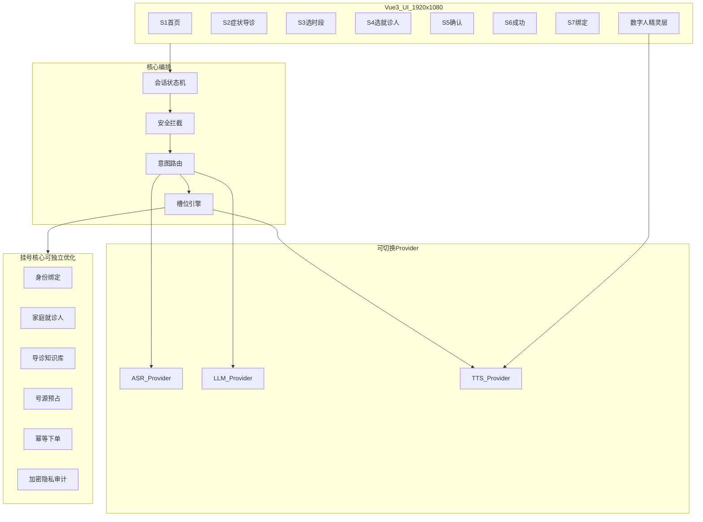

# 医鸿 IPTV 数字人 · 项目总方案

## 版本 v1.0 · 日期 2026-11-08

| 项 | 内容 |
|---|---|
| 场景 | 龙华人民医院 IPTV 大屏 · 数字人语音对话与挂号预约 Demo |
| 目标用户 | 老年慢病患者为主（适老化为硬约束） |
| 技术路线 | 网页先跑通：Vue3 + Vite；后续迁 APK / 鸿蒙 |
| 关联文档 | [README](./README.md)、[01 工程规范](./01-目录与工程规范-v1.0.md)、[04 挂号核心](./04-挂号预约核心模块方案-v1.0.md) |
| 依据交付包 | `医鸿IPTV数字人-交付包` 方案文档 v0.1/v0.3 + 视觉稿 S1–S7 + 语音 Demo |

---

## 1. 一句话目标

让老人对着电视上的数字人说话，能听懂、能安全回答，并能走完「说症状 → 选时段 → 确认挂号」的 Demo 闭环；同时把语音、AI、挂号、数字人、API 切换拆成可独立优化的模块，为后续真对接与机顶盒迁移留接口。

---

## 2. 六大需求映射

| 编号 | 需求 | 本阶段落点 | 主文档 |
|---|---|---|---|
| R1 | 语音对话（麦克风 → 文字） | 三通道 ASR：浏览器 / 云端（含讯飞适配位）/ Mock | [02](./02-语音识别模块方案-v1.0.md) |
| R2 | 接入 AI 处理对话 | LLM Provider + 剧本降级；危急词硬拦截在 LLM 前 | [03](./03-AI对话与API切换方案-v1.0.md) |
| R3 | 龙华挂号预约流程（核心） | 对齐 S1–S7；子模块独立；加密/隐私/适老化可演示 | [04](./04-挂号预约核心模块方案-v1.0.md) |
| R4 | 数字人动作与嘴型 | 精灵图 idle / 说话 / viseme；无对话随机 idle | [05](./05-数字人精灵图与动作方案-v1.0.md) |
| R5 | 独立 API 切换与内置调控 | ProviderRegistry + 服务端代理配置热切换 | [03](./03-AI对话与API切换方案-v1.0.md)、[06](./06-接口清单与数据契约-v1.0.md) |
| R6 | 网页 Demo → APK / 鸿蒙 | 业务与 Provider 平台无关；壳层可替换 | [07](./07-跨端迁移方案-v1.0.md) |

---

## 3. 范围边界

### 3.1 交付包已有（可复用思想与规格）

- 五层对话架构、半双工与 L1 按键打断
- `VoiceInput` 事件边界与语音参数表
- 挂号难点：身份、号源时效、代劳；路径 C→B
- 危急词前置拦截、适老化 8 条硬规则
- 原生 JS Demo：状态机、三通道语音、SVG 口型占位

### 3.2 本方案新增（相对交付包 Demo）

- 以 **Vue3 + Vite** 重建前端工程与模块目录
- **挂号核心**按子模块拆分，便于模块级优化
- **Provider 注册表**支持 ASR/LLM/TTS 独立切换与内置调控
- **精灵图动作体系**（idle / 倾听 / 思考 / 说话嘴型）替代纯 SVG 占位
- Demo 级 **加密、脱敏、明示同意、审计日志** 可演示链路
- 明确 **跨端分层**，避免业务写死在浏览器 API 上

### 3.3 本阶段不做

| 项 | 说明 |
|---|---|
| 真 HIS / 预约平台 | 使用 Mock 中台；接口形状按终态设计 |
| 真支付 / 医保 | 到院付或跳过 |
| 真公众号绑定 | Mock 二维码 + 轮询状态机 |
| 机顶盒播控报批 | 仅文档预留探测清单 |
| 音素级精确口型 | Demo 用节奏嘴型；接口预留 viseme 时间戳 |
| 真实 KMS / mTLS 生产密钥体系 | Demo 用会话 Token + 脱敏 + 代理持钥 |

---

## 4. 总体架构



### 4.1 分层说明

| 层 | 职责 | 可替换性 |
|---|---|---|
| 接入层 | HTTP、本地代理、遥控器键值、麦克风 | 跨端时替换输入源 |
| 会话层 | IDLE / LISTENING / THINKING / SPEAKING / EMERGENCY | 全端共用 |
| 编排层 | 安全拦截、意图、槽位、打断 | 全端共用 |
| 能力层 | ASR / LLM / TTS Provider | 配置热切换 |
| 业务层 | 挂号各子模块 | 模块级独立优化 |
| 数据层 | Mock JSON、事件日志、审计 | Demo 本地；终态接中台 |

### 4.2 会话状态机（沿用交付包，Vue3 实现）

| 状态 | 含义 | 典型进入条件 |
|---|---|---|
| IDLE | 待机，播放 idle 动作 | 启动、对话结束、Esc |
| LISTENING | 收音中 | 空格 / 遥控器确认开始说 |
| THINKING | 识别完成，等待编排结果 | ASR final |
| SPEAKING | TTS + 嘴型 + 字幕 | 首句可播时 |
| EMERGENCY | 危急词红屏，指引 120 | 安全规则命中 |

半双工原则：电视外放场景不做远场全双工打断；Demo 使用 **按键打断（L1）**。

---

## 5. 挂号路径策略

| 阶段 | 路径 | 做法 | 本方案 |
|---|---|---|---|
| Demo / 冷启动 | C | 导诊 + Mock 号源/凭证（或二维码转手机） | **当前采用** |
| 终态 | B | 自建预约中台对接医院统一预约 | 接口形状预留，见 04、06 |
| 不推荐起步 | A | 直连 HIS | 仅作远期说明 |

数字人价值重心：**导诊与确认复述**，不是重复做一个公众号挂号入口。

---

## 6. 适老化硬规则（Demo 必须体现）

1. 每轮只问一个问题  
2. 关键步骤必须语音复述确认  
3. TTS 语速约 0.85–0.88  
4. 单句尽量不超过 20 字  
5. 低置信度不猜测，引导再说一次或切按键  
6. 追问最多两轮，超时转按键菜单  
7. 字幕常驻，建议 48–64px（1920×1080）  
8. 普通话为主，方言通道预留  

视觉基准：深墨绿医疗配色、正文 ≥32px，对齐交付包 S1–S7。

---

## 7. 安全、隐私、加密（Demo 可演示）

| 能力 | Demo 做法 | 说明 |
|---|---|---|
| 明示同意 | 首次绑定大字 + 语音确认 | 见 04 consent 子模块 |
| 最小必要 | 电视不展示身份证全码、诊断明细 | 脱敏展示 |
| Key 不出前端 | `config` 仅在服务端；前端只拿通道可用性 | 见 03、06 |
| 传输 | 开发用 localhost；预留 HTTPS | 机顶盒上线强制 TLS |
| 会话 | 设备会话 Token + 过期 | Mock 签发 |
| 幂等与限频 | hold/confirm 带 idempotencyKey | 防重复下单 |
| 审计 | 绑定/切换就诊人/代挂写审计日志 | Mock 落盘或内存 |
| 危急拦截 | 规则引擎在 LLM 前，5ms 级短路 | 不可交给模型自由判断 |

---

## 8. 技术栈声明

| 层级 | 选型 | 备注 |
|---|---|---|
| 前端 | **Vue3 + Vite** | 用户约定；不混用 Vue2 |
| 语言 | JavaScript（Demo）或 TypeScript（若后续引入须单独说明） | 初版方案按 JS + 中文注释 |
| 状态 | 优先 Composition API；若引入 Pinia 须在工程规范中单列原因 | 见 01 |
| 后端代理 | Node.js（Express 或原生 http） | 持有 API Key、转发 ASR/LLM |
| UI 组件库 | Demo 阶段自研大屏组件，不默认引入 Element Plus 等 | 避免遥控器焦点被组件库绑死 |
| 数字人 | Canvas / CSS Sprite 播放器 | 规格见 05 |

引入任何额外框架前，必须在文档中写清：为什么、影响哪些模块、是否阻碍跨端。

---

## 9. 实施阶段

| 阶段 | 产出 | 验收要点 |
|---|---|---|
| P0 方案 | 本 `docs/` 套件 | 六大需求可映射；挂号子模块边界清晰 |
| P1 工程骨架 | Vue3 工程 + 代理 + 模块空壳 | 目录符合 01；能切换 Mock 通道 |
| P2 语音+AI | ASR 三通道 + LLM/剧本 + API 切换面板 | 改配置可换模型；失败可降级 |
| P3 挂号闭环 | S1–S7 Mock 全流程 | 同意、脱敏、预占、确认、凭证可演示 |
| P4 数字人 | 精灵图资源 + idle/嘴型 | 无对话随机 idle；说话有嘴型 |
| P5 跨端预研 | APK/鸿蒙壳探测文档落地 | 见 07 |

---

## 10. 单轮对话时序（目标）

```text
按键开始听 → ASR partial 上屏 → final
  → 安全规则 → 意图/槽位（挂号走确定性脚本）
  → LLM 或剧本（非挂号闲聊）
  → 首句 TTS + 嘴型 + 字幕
目标首字可感响应：约 1.7–2.7s（沿用交付包预算）
```

挂号意图：**不允许 LLM 自由编造业务流程**；只允许填槽与话术模板。

---

## 11. 风险与对策

| 风险 | 对策 |
|---|---|
| Chrome 国内 Web Speech 失败 | 三通道 + 自动降级（浏览器→云→Mock） |
| 现场无麦/断网 | Mock 通道与文字输入兜底 |
| 号源演示「说好了挂不上」 | Demo 预占 90–120s + 过期明确提示 |
| 医疗合规 | 禁答域 + 危急拦截 + 「AI 生成」标识 |
| 老盒子 WebView 能力差 | 渲染不押在旧盒；盒端哑终端或新壳，见 07 |
| API 厂商协议不一 | Provider 适配器隔离；OpenAI 兼容优先，讯飞单独适配 |

---

## 12. 成功标准（Demo）

1. 能用电脑麦克风完成一轮「说症状 → 得到科室与时段候选」  
2. 能在界面切换 ASR/LLM 通道且无需改业务代码  
3. 能走完绑定（Mock）→ 选人 → 确认 → 成功凭证  
4. 数字人待机有 idle，说话有嘴型变化  
5. 危急词触发红屏 120 指引  
6. 敏感信息脱敏；Key 不出现在前端网络面板  

---

## 13. 修订记录

| 版本 | 日期 | 说明 |
|---|---|---|
| v1.0 | 2026-11-08 | 首版总方案：Vue3 路线 + 六大需求映射 + 模块化架构 |
