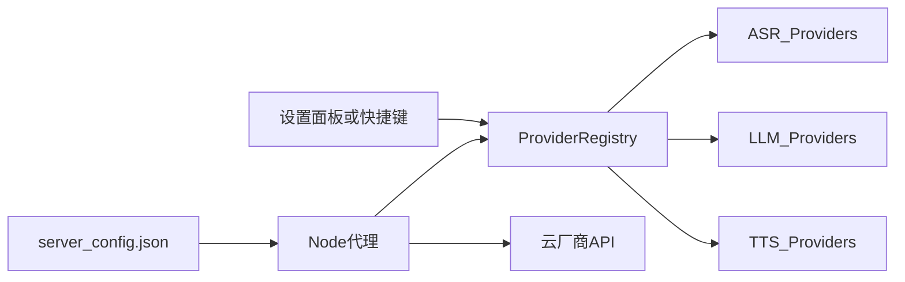

# 医鸿 IPTV 数字人 · AI 对话与 API 切换方案

## 版本 v1.0 · 日期 2026-11-08

| 项 | 内容 |
|---|---|
| 目标 | 接入 AI 处理对话；ASR/LLM/TTS 可独立切换并带内置调控 |
| 模块 | `src/modules/ai`、`src/modules/api-switch` |
| 关联 | [02 语音](./02-语音识别模块方案-v1.0.md)、[06 接口](./06-接口清单与数据契约-v1.0.md) |

---

## 1. 设计原则

1. **业务不绑厂商**：挂号与导诊只依赖抽象 Provider，不 import 某一家 SDK  
2. **Key 不出浏览器**：全部经本地/院内部署代理  
3. **失败可演示**：LLM 挂了仍走医疗剧本；ASR 挂了走 mock  
4. **挂号不靠自由发挥**：挂号意图走槽位脚本；LLM 仅辅助闲聊/解释类  
5. **安全在模型前**：危急词与禁答域硬编码拦截  

---

## 2. Provider 注册表（API 切换核心）



### 2.1 注册表示意

| 字段 | 说明 |
|---|---|
| `id` | 如 `llm.deepseek`、`asr.sensevoice`、`asr.xfyun`、`tts.browser` |
| `type` | `asr` / `llm` / `tts` |
| `enabled` | 是否可选 |
| `priority` | 降级顺序，数字越小越优先 |
| `controls` | 超时、重试、温度等调控项 |
| `adapter` | 服务端适配器名 |

### 2.2 运行时切换

| 方式 | 行为 |
|---|---|
| 改 `server/config.json` 后刷新 | 代理每次请求重读配置（对齐交付包） |
| 前端设置面板 | `POST /api/providers/activate` 指定 `type+id`（Demo 可做内存覆盖） |
| 快捷键 | 仅切换 ASR 通道（1/2/3）；LLM 建议面板切换防误触 |

切换后：

- 进行中的请求可 `abort`  
- 下一轮对话使用新 Provider  
- UI 常驻显示当前：ASR / LLM / TTS 名称  

---

## 3. LLM 对话模块

### 3.1 能力

| 能力 | Demo |
|---|---|
| 流式输出 | SSE，前端按句切分送 TTS |
| 上下文 | 最近 N 轮（建议 6 条） |
| System Prompt | 适老化、禁诊断、禁给药剂量、短句 |
| 中断 | 用户按键打断时 abort fetch |
| 降级 | HTTP 失败 → 意图剧本 |

### 3.2 与意图路由的关系

```text
final 文本
  → safetyGuard（危急 / 禁答）
  → intentRouter
      ├─ registration_* → 槽位引擎（不走自由 LLM 编流程）
      ├─ 固定技能（血压/血糖说明等）→ 审核过的剧本优先
      └─ chitchat / 未知 → LLM，失败再剧本兜底
```

### 3.3 推荐 Demo 模型配置（可换）

| 用途 | 示例 |
|---|---|
| 对话 | DeepSeek / 通义 / 智谱 等 OpenAI 兼容 |
| 配置键 | `llm.baseUrl` `llm.apiKey` `llm.model` `llm.temperature` `llm.maxTokens` |

默认调控：

| 参数 | 默认 | 说明 |
|---|---|---|
| `temperature` | `0.6` | 医疗说明可降到 0.3 |
| `maxTokens` | `400` | 防止长篇大论 |
| `timeoutMs` | `15000` | 超时降级剧本 |
| `retry` | `1` | 仅网络错误重试 |
| `historyTurns` | `6` | 上下文条数 |

---

## 4. TTS 与口型衔接

| 引擎 | Demo | 口型 |
|---|---|---|
| `browser` | `speechSynthesis`，语速 0.88 | 节奏 viseme（无音素时间戳） |
| `cloud`（预留） | 返回音频 URL + 可选 viseme 时间戳 | 精确嘴型升级点 |

`modules/ai` 或编排层在「首句可播」时通知 `modules/avatar.startSpeak()`；结束或打断时 `stopSpeak()`。

---

## 5. 内置调控面板（测试用）

面向你后续「切换相关 API」的测试需求，Demo 提供独立调控区（可放设置页，避开老人主路径）：

| 调控项 | 作用 |
|---|---|
| ASR Provider | browser / cloud-openai / xfyun / mock |
| LLM Provider | deepseek / 其它兼容 / script-only |
| TTS Provider | browser / cloud（预留） |
| temperature / maxTokens | 当场改，下一轮生效 |
| 降级顺序 | 拖拽或上下移 priority |
| 强制剧本 | 忽略 LLM，只走脚本（验收挂号用） |
| 超时 ms | 模拟慢网 |
| 医疗热词开关 | 影响 ASR 后处理 |

主界面老人模式：**默认隐藏**高级调控；开发者模式快捷键打开（如 `Ctrl+,`）。

---

## 6. 安全规则（AI 侧必须遵守）

| 规则 | 处理 |
|---|---|
| 胸痛、喘不上气、呕血、说不出话、自伤等 | EMERGENCY，播 120，不挂号 |
| 诊断、良恶性判断、具体给药剂量 | 拒答 + 建议线下就医 |
| 承诺疗效 | 禁止 |
| 输出标识 | 常驻「AI 生成，仅供参考」 |

否定句误触发（如「没有胸痛」）在 P2 用简单否定检测缓解；交付包已知风险，方案中列为待增强。

---

## 7. 配置文件形状（服务端）

```json
{
  "llm": {
    "activeId": "llm.deepseek",
    "providers": [
      {
        "id": "llm.deepseek",
        "enabled": true,
        "baseUrl": "https://api.deepseek.com/v1",
        "apiKey": "",
        "model": "deepseek-chat",
        "temperature": 0.6,
        "maxTokens": 400,
        "timeoutMs": 15000,
        "priority": 1
      },
      {
        "id": "llm.script",
        "enabled": true,
        "priority": 99
      }
    ]
  },
  "asr": {
    "activeId": "asr.mock",
    "providers": []
  },
  "tts": {
    "activeId": "tts.browser",
    "rate": 0.88
  },
  "fallbackOrder": {
    "asr": ["asr.browser", "asr.cloud", "asr.mock"],
    "llm": ["llm.deepseek", "llm.script"]
  }
}
```

前端 `GET /api/config` 仅返回：各 `id`、`enabled`、`activeId`、展示名、调控项当前值；**剥离 apiKey**。

---

## 8. 验收用例

| 编号 | 场景 | 期望 |
|---|---|---|
| A1 | LLM Key 有效 | 流式回答 + 字幕 + 嘴型 |
| A2 | LLM Key 无效 | 静默降级剧本，演示不中断 |
| A3 | 切换 LLM 模型 | 下一轮走新模型 |
| A4 | 切换 ASR 到 mock | 无麦可完整对话 |
| A5 | 强制剧本模式 | 挂号流程仍完整 |
| A6 | 说「胸口疼」 | 不经过 LLM，直接红屏 |
| A7 | 打断 SPEAKING | abort LLM/TTS，回 LISTENING/IDLE |

---

## 9. 修订记录

| 版本 | 日期 | 说明 |
|---|---|---|
| v1.0 | 2026-11-08 | 首版：注册表、调控面板、LLM/TTS 与安全边界 |
