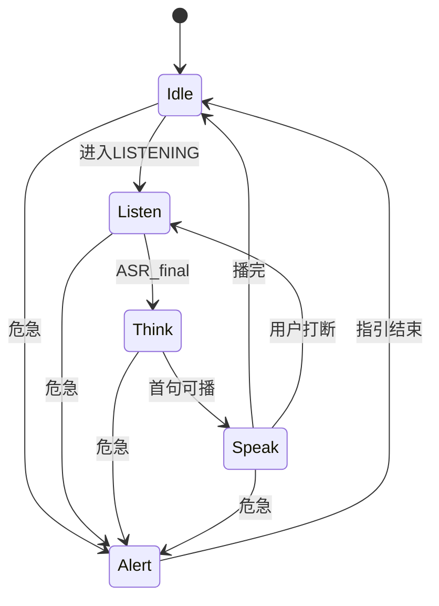

# 医鸿 IPTV 数字人 · 精灵图与动作方案

## 版本 v1.0 · 日期 2026-11-08

| 项 | 内容 |
|---|---|
| 目标 | 待机随机 idle、对话时躯干动作 + 嘴型变化；资源可替换 |
| 模块 | `src/modules/avatar` |
| 资源 | `public/sprites/` |
| 关联 | [00 总方案](./00-项目总方案-v1.0.md)、[03 AI/TTS](./03-AI对话与API切换方案-v1.0.md) |

---

## 1. 现状与目标

| 项 | 交付包 Demo | 本方案 Demo |
|---|---|---|
| 形象 | 内嵌 SVG（医小鸿 / 鸿医生） | **精灵图（Sprite Sheet）** 播放，SVG 可作开发占位 |
| 嘴型 | 8 viseme 节奏循环 | 同 8 viseme；接口预留时间戳驱动 |
| 待机 | 眨眼 + 呼吸 | **多套 idle 随机播放** |
| 角色 | 代码切换 | 资源包切换（护士默认） |

---

## 2. 动作状态机



| 动作态 | 触发 | 播放内容 |
|---|---|---|
| `idle` | 无对话 | 随机挑选 idle-A/B/C 循环或播完再随机 |
| `listen` | 收音中 | 微前倾 / 注视；可轻微点头 |
| `think` | 等待结果 | 短暂思考帧（1–2s 可循环） |
| `speak` | TTS 播放 | 说话躯干 + **嘴型层** |
| `alert` | 危急 | 关切表情；避免夸张惊吓老人 |

---

## 3. 精灵图规格

### 3.1 分层

为降低换装与嘴型成本，采用 **双层（或三层）合成**：

| 层 | 内容 | 说明 |
|---|---|---|
| Body | 身体 + 手臂 + 不含嘴的头部 | idle/listen/think/speak 躯干帧 |
| Mouth | 嘴型 viseme | 叠在固定嘴部锚点 |
| （可选）Blink | 闭眼帧 | 定时叠加，增强生命感 |

### 3.2 画幅与性能

| 参数 | Demo 建议 |
|---|---|
| 逻辑分辨率 | 角色区域约 720×1080 内适配，或 512×768 资源拉伸 |
| 单帧尺寸 | 512×768 px（可按美术调整，但整套统一） |
| 帧率 | 身体 8–12 fps；嘴型 8–10 fps |
| 格式 | PNG 序列打成 sheet，或逐帧 PNG；WebP 可选 |
| 透明 | 必须 alpha，底透明 |
| 色调 | 与大屏深墨绿场景协调；护士服清爽、非荧光 |

### 3.3 目录约定

```text
public/sprites/
  nurse-xiaohong/
    meta.json                 # 帧尺寸、锚点、动画定义
    body-idle-a.png           # 或 sheet
    body-idle-b.png
    body-idle-c.png
    body-listen.png
    body-think.png
    body-speak.png
    body-alert.png
    mouth-sil.png
    mouth-m.png
    mouth-a.png
    mouth-e.png
    mouth-i.png
    mouth-o.png
    mouth-u.png
    mouth-smile.png
  doctor-hong/                # 预留第二形象
    meta.json
```

### 3.4 meta.json 示意

```json
{
  "characterId": "nurse-xiaohong",
  "frameSize": { "w": 512, "h": 768 },
  "mouthAnchor": { "x": 256, "y": 420 },
  "animations": {
    "idleA": { "layer": "body", "fps": 8, "frames": ["body-idle-a"], "loop": true },
    "idleB": { "layer": "body", "fps": 8, "frames": ["body-idle-b"], "loop": true },
    "idleC": { "layer": "body", "fps": 8, "frames": ["body-idle-c"], "loop": true },
    "listen": { "layer": "body", "fps": 8, "frames": ["body-listen"], "loop": true },
    "think": { "layer": "body", "fps": 6, "frames": ["body-think"], "loop": true },
    "speakBody": { "layer": "body", "fps": 8, "frames": ["body-speak"], "loop": true },
    "alert": { "layer": "body", "fps": 6, "frames": ["body-alert"], "loop": true }
  },
  "visemes": ["sil", "m", "a", "e", "i", "o", "u", "smile"]
}
```

---

## 4. 播放策略

### 4.1 无对话（Idle）

1. 进入 `idle` 后，从 `{idleA, idleB, idleC}` **随机**选一个  
2. 播放完整循环 2–4 轮或 6–10 秒后，再随机下一个（避免单一循环呆板）  
3. 随机时避免连续两次同一个（简单去重）  
4. 眨眼：每 3–6 秒触发一次短闪（若有 Blink 层）  

### 4.2 说话（Speak）

1. 身体切到 `speakBody`  
2. 嘴型：  
   - **Demo 默认**：按固定序列节奏切换（约每 100–120ms），与交付包一致  
   - **升级**：TTS 若返回 viseme 时间戳，则 `setViseme(name, atMs)` 精确对齐  
3. 字幕与 TTS 由会话层驱动；avatar 只接收 `startSpeak` / `stopSpeak` / `setViseme`  

### 4.3 打断

- 立即 `stopSpeak`：嘴型回 `sil`，身体回 `listen` 或 `idle`  
- 不播完当前 idle 也可以硬切（优先级：alert > speak/listen > idle）  

---

## 5. 模块对外接口

```js
/**
 * 数字人播放器门面。
 * UI 只调用这些方法，不直接操作 canvas 细节。
 */
export function mountAvatar(el, characterId) {}
export function setAction(action) {}          // idle|listen|think|speak|alert
export function startSpeak() {}               // 开始节奏嘴型或等待时间戳
export function stopSpeak() {}
export function setViseme(name) {}            // sil/m/a/e/i/o/u/smile
export function scheduleVisemes(timeline) {}  // [{t, name}] 升级用
export function setCharacter(characterId) {}
export function destroyAvatar() {}
```

与会话层绑定建议：

| 会话状态 | Avatar action |
|---|---|
| IDLE | `idle`（随机） |
| LISTENING | `listen` |
| THINKING | `think` |
| SPEAKING | `speak` |
| EMERGENCY | `alert` |

---

## 6. 资源生产说明

本阶段 **方案定规格**；精灵图资源可在实现阶段生成。

生产建议：

1. 先出一张标准站姿定稿（护士「医小鸿」）  
2. 导出 idle 三套轻微差异（重心左右、手势、点头）  
3. 导出 listen / think / speak / alert 身体  
4. 单独导出 8 嘴型，锚点对齐  
5. 用 `meta.json` 装配；缺资源时回退交付包 SVG 占位，保证开发不堵  

若使用 AI 绘图：须统一构图、同一角色 ID、透明底、禁止每张构图漂移导致锚点错位。

---

## 7. 适老化与观感

| 要求 | 说明 |
|---|---|
| 不过度夸张 | 老人观看距离近，避免频繁大幅动作 |
| 危急不恐怖 | alert 用关切而非惊恐 |
| 性能 | 旧设备预留「静态图 + 仅嘴型」降级开关 |
| 无障碍 | 动作不是唯一信息；字幕与语音必须同步可读 |

---

## 8. 验收

| 编号 | 场景 | 期望 |
|---|---|---|
| D1 | 开机无人说话 | 可见至少 2 种 idle 轮换 |
| D2 | 开始收音 | 切 listen |
| D3 | 数字人回答 | 身体 speak + 嘴型变化 |
| D4 | 打断 | 嘴型立即停止 |
| D5 | 危急 | alert 动作 + 红屏（UI） |
| D6 | 缺 sprite | 回退占位不白屏 |

---

## 9. 修订记录

| 版本 | 日期 | 说明 |
|---|---|---|
| v1.0 | 2026-11-08 | 首版：分层精灵图、idle 随机、嘴型与会话绑定、meta 规格 |
