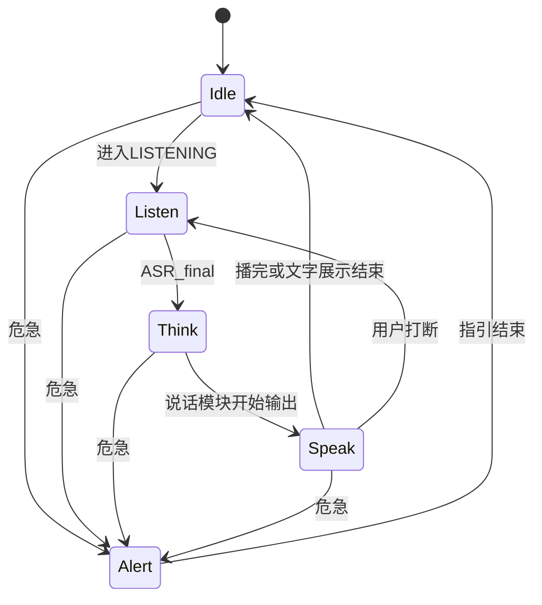

# 医鸿 IPTV 数字人 · 精灵图、动作与说话模块方案

## 版本 v1.3 · 日期 2026-11-08

| 项 | 内容 |
|---|---|
| 目标 | 前期用**简单资源包**可切换护士形象；待机 idle + 说话嘴型；**说话模块先文字、后 TTS** |
| 模块 | `src/modules/avatar`（形象/动作）+ `src/modules/avatar/speak`（说话输出） |
| 资源 | `public/sprites/` + 交付包 SVG 占位 |
| 关联 | [00](./00-项目总方案-v1.2.md)、[02](./02-语音识别模块方案-v1.2.md)、[03](./03-AI对话与API切换方案-v1.2.md)、[08](./08-首次绑定人机与实验方案-v1.2.md)、[09](./09-上线边界与运营治理补强-v1.0.md) |
| 本版增量 | 遥控确认进说话；Demo text / 试点字幕+可选语音 |

---

## 1. 前期原则：先简单、可切换、可升级

| 原则 | 说明 |
|---|---|
| 先跑通 | Demo 第一阶段允许 **SVG 占位包**，不阻塞挂号与语音联调 |
| 多包可选 | 护士默认，但提供 **至少 3 套** 可切换资源包，方便演示挑观感 |
| 说话解耦 | 「说什么」走 `speak` 模块；「长什么样/怎么动」走 avatar 播放器 |
| 先文字后语音 | 说话输出默认 **字幕打字机**；配置打开后再接浏览器/云 TTS |

---

## 2. 护士资源包清单（可多选）

设置面板或快捷键切换 `avatar.packId`。包之间 **meta 契约相同**，只换画风/帧数量。

| packId | 名称 | 复杂度 | 内容 | 适用 |
|---|---|---|---|---|
| `nurse-svg-default` | 医小鸿 · SVG 默认 | **最低** | 沿用交付包 SVG：眨眼/呼吸/8 嘴型 | **推荐作为开发默认** |
| `nurse-svg-doctor` | 鸿医生 · SVG | 低 | 交付包医生模板，同套口型接口 | 对比男/女形象 |
| `nurse-simple-a` | 医小鸿 · 简版精灵 A（青白） | 中 | 少量 PNG：idle×2 + listen + speak + 嘴型 4～8 | 第一次上精灵图 |
| `nurse-simple-b` | 医小鸿 · 简版精灵 B（暖米） | 中 | 同帧结构，暖色护士服，便于现场二选一 | 观感 A/B |
| `nurse-full` | 医小鸿 · 完整精灵 | 高 | idle×3 + listen/think/speak/alert + 全嘴型 | 后期美术到位后启用 |

### 2.1 目录约定

```text
public/sprites/
  packs.json                          # 包注册表（前端可读）
  nurse-svg-default/                  # 可指向代码内 SVG 模板，无 png 亦可
    meta.json
  nurse-svg-doctor/
    meta.json
  nurse-simple-a/
    meta.json
    body-idle-1.png
    body-idle-2.png
    body-listen.png
    body-speak.png
    mouth-sil.png
    mouth-a.png
    mouth-o.png
    mouth-m.png
    ...
  nurse-simple-b/
    meta.json
    ...（帧名与 A 对齐，便于热切换）
  nurse-full/
    meta.json
    ...（完整帧，见历史规格）
```

### 2.2 packs.json 示意

```json
{
  "defaultPackId": "nurse-svg-default",
  "packs": [
    {
      "id": "nurse-svg-default",
      "label": "医小鸿（SVG 简单）",
      "role": "nurse",
      "engine": "svg",
      "complexity": "low"
    },
    {
      "id": "nurse-svg-doctor",
      "label": "鸿医生（SVG）",
      "role": "doctor",
      "engine": "svg",
      "complexity": "low"
    },
    {
      "id": "nurse-simple-a",
      "label": "医小鸿 精灵简版·青白",
      "role": "nurse",
      "engine": "sprite",
      "complexity": "medium"
    },
    {
      "id": "nurse-simple-b",
      "label": "医小鸿 精灵简版·暖米",
      "role": "nurse",
      "engine": "sprite",
      "complexity": "medium"
    },
    {
      "id": "nurse-full",
      "label": "医小鸿 完整精灵",
      "role": "nurse",
      "engine": "sprite",
      "complexity": "high",
      "enabled": false
    }
  ]
}
```

`enabled: false` 的包不出现在老人主界面，只在开发者设置里可选。

### 2.3 简版精灵最低帧（simple-a / simple-b）

前期不必做满完整规格，**最低可运行集**：

| 资源 | 是否必需 | 说明 |
|---|---|---|
| idle ×2 | 必需 | 无对话时随机切换 |
| listen ×1 | 建议 | 没有则 idle 代替 |
| speak 身体 ×1 | 建议 | 没有则 idle + 只动嘴 |
| 嘴型 sil/a/o/m | 必需 | 可先 4 个，后续扩到 8 |
| think / alert | 可缺 | 缺省回退 idle / speak |

完整帧规格（512×768、双层合成、8 viseme）仍作为 `nurse-full` 目标，不挡前期。

---

## 3. 动作状态机（与包无关）



| 动作态 | 触发 | 播放内容 |
|---|---|---|
| `idle` | 无对话 | 随机 idle（简版至少 2 套） |
| `listen` | 收音中 | 倾听姿态；缺帧则 idle |
| `think` | 等待结果 | 缺帧则 idle |
| `speak` | 说话模块输出中 | 说话身体 + 嘴型 |
| `alert` | 危急 | 关切；缺帧则 speak |

---

## 4. 说话模块 `avatar/speak`（先文字，后 TTS）

说话模块独立于「长什么样」，统一对外接口，便于前期只开字幕、后期开声音。

### 4.1 分阶段

| 阶段 | 模式 ID | 行为 | 何时用 |
|---|---|---|---|
| P0 Demo 默认 | `text` | 大字幕打字机；嘴型轻动；可不出声 | 开发联调 |
| P0b 试点建议 | `text` + 可选 `browser_tts` | **字幕常驻**；语音可开（识字困难老人友好） | 试点默认建议开声可配 |
| P1 | `browser_tts` | 浏览器朗读 + 字幕 | 本机有声 |
| P2 | `cloud_tts` | 云 TTS + 可选 viseme | 口型升级 |

配置示例：

```json
{
  "speak": {
    "mode": "text",
    "rate": 0.88,
    "charsPerSecond": 6,
    "subtitleSizePx": 56
  }
}
```

### 4.2 对外接口

```js
/**
 * 说话模块：负责「把回复交给用户感知」。
 * 前期 mode=text 只驱动字幕与嘴型节奏；后期同一接口接 TTS。
 */
export function configureSpeak(options) {}

/** 开始说一段话（可含多句）；返回可取消的句柄 */
export function speak(text, options = {}) {}

/** 立即停止当前输出（打断时调用） */
export function stopSpeak(reason = 'user_interrupt') {}

/** 当前是否正在输出 */
export function isSpeaking() {}

/**
 * 事件：
 * - speak.start / speak.sentence / speak.char / speak.end / speak.interrupted
 */
export function onSpeakEvent(handler) {}
```

与 avatar 播放器的关系：

```text
编排层得到回复文本
  → speak.speak(text)
      → 通知 avatar.setAction('speak') + 嘴型节奏
      → mode=text：只更新字幕板
      → mode=*tts：播声音 + 字幕
  → 用户打断
      → speak.stopSpeak()
      → avatar.stopSpeak() / setAction('listen'|'idle')
      → voice 侧按 02 文档 abort（若正在听则另议）
```

### 4.3 文字模式细则（P0）

| 项 | 约定 |
|---|---|
| 展示位置 | 大屏字幕区，≥48px，高对比 |
| 节奏 | 按句切分；句内可逐字（`charsPerSecond` 可调） |
| 嘴型 | 有字在出则循环简单嘴型；句间回 `sil` |
| 适老化 | 单句尽量短；绑定读码可强制更慢 |
| 无障碍 | 字幕常驻；试点叠加可选语音 |

### 4.5 遥控确认切入说话（v1.3）

| 状态 | 确认键行为 |
|---|---|
| IDLE | **直接进入说话/收音**（LISTENING），无需先聚焦麦克风按钮 |
| 其它有焦点控件 | 先激活控件；返回后仍可一键说话 |

电脑验证：键盘空格或 HID 蓝牙遥控映射，**不必**先接 IPTV 真盒。见 [09 §6](./09-上线边界与运营治理补强-v1.0.md)。

### 4.4 升级到 TTS 时不必改业务

挂号/AI 编排层始终只调用 `speak(text)`。  
切换 `speak.mode` 即可，不改 `registration` / `intentRouter`。

---

## 5. 打断时数字人与说话模块怎么配合

用户按空格/遥控器打断（半双工 L1）时：

1. `speak.stopSpeak('user_interrupt')`：停字幕推进、停 TTS（若有）、发 `speak.interrupted`  
2. `avatar`：嘴型立即 `sil`，动作切 `listen`（若紧接着要说话）或 `idle`  
3. 若同时在收音：由 [02](./02-语音识别模块方案-v1.2.md) 的 `abort()` 处理，**禁止迟到的 final 入槽**  
4. 编排层：abort 进行中的 LLM 请求；清空待播句队列  

危急 `alert` 态：按产品策略可设为不可被普通打断（交付包 L0）；Demo 若允许 Esc 退出，须写进设置说明。

---

## 6. 播放器对外接口（形象层）

```js
export function mountAvatar(el, packId) {}
export function setPack(packId) {}          // 热切换护士/医生资源包
export function listPacks() {}              // 读 packs.json
export function setAction(action) {}
export function startSpeakMotion() {}       // 仅动作/嘴型，不负责文案
export function stopSpeakMotion() {}
export function setViseme(name) {}
export function destroyAvatar() {}
```

业务层优先用 `speak.speak()`，不要直接拼字幕逻辑。

---

## 7. 绑定态（沿用 v1.1）

绑定页字幕优先；读码用 `speak` 的慢速文字（或 TTS）。详见 [08](./08-首次绑定人机与实验方案-v1.2.md)。

| 阶段 | Avatar | speak 建议 |
|---|---|---|
| 明示同意 | speak 动作 | text/tts 慢速 |
| 出码等待 | idle | 少说话 |
| 逐位读码 | speak | 3+3 停顿；支持再说一遍 |
| 成功 | smile | 短句 |

---

## 8. 资源生产顺序（务实）

1. **立刻**：启用 `nurse-svg-default`（交付包已有）  
2. **可选**：打开 `nurse-svg-doctor` 做形象对比  
3. **下一迭代**：制作 `nurse-simple-a` / `nurse-simple-b` 两套最低帧 PNG，现场让人挑  
4. **美术定稿后**：再填 `nurse-full`  

AI 出图时：同一 pack 内构图、锚点一致；simple-a 与 simple-b 帧名对齐。

---

## 9. 适老化与观感

| 要求 | 说明 |
|---|---|
| 不过度夸张 | 观看距离近 |
| 危急不恐怖 | 关切而非惊恐 |
| 前期以字为先 | 老人可能听不清；文字模式保证信息到达 |
| 换包不换流程 | 切换 pack 不影响挂号步骤 |

---

## 10. 验收

| 编号 | 场景 | 期望 |
|---|---|---|
| D1 | 默认包 | `nurse-svg-default` 可待机 + 嘴型 |
| D2 | 切换包 | simple-a / simple-b / doctor 可切换且不白屏 |
| D3 | speak.mode=text | 有字幕推进；可无声音 |
| D4 | 改为 browser_tts | 同一 `speak()` 接口出声 |
| D5 | 说话中打断 | 字幕/声音/嘴型立即停 |
| D6 | 无对话 | 至少 2 种 idle（或 SVG 呼吸眨眼） |
| D7 | 缺帧包 | 回退策略生效，不崩溃 |

---

## 11. 修订记录

| 版本 | 日期 | 说明 |
|---|---|---|
| v1.0 | 2026-11-08 | 首版精灵图规格 |
| v1.1 | 2026-11-08 | 绑定态引导 |
| v1.2 | 2026-11-08 | 多套简易护士包；说话模块先文字后 TTS；打断协同 |
| v1.3 | 2026-11-08 | 遥控确认进说话；试点字幕+可选语音；链到 09 |
