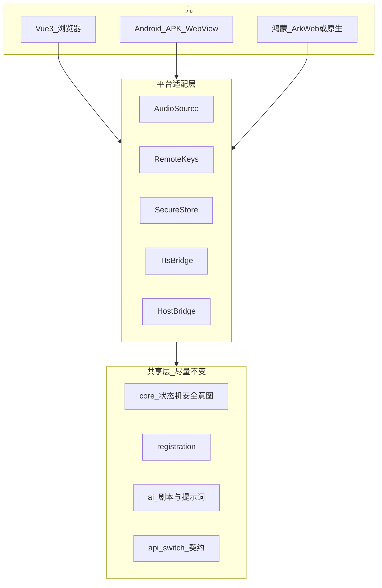

# 医鸿 IPTV 数字人 · 跨端迁移方案

## 版本 v1.0 · 日期 2026-11-08

| 项 | 内容 |
|---|---|
| 目标 | 网页 Demo 可迁移到 APK（Android 机顶盒壳）与鸿蒙，避免业务重写 |
| 关联 | [00](./00-项目总方案-v1.2.md)、[01](./01-目录与工程规范-v1.0.md)、[08](./08-首次绑定人机与实验方案-v1.2.md)、[09 遥控验证](./09-上线边界与运营治理补强-v1.0.md) |
| 依据 | 交付包关于「盒子做哑终端 / 半双工按键打断」的判断 |

---

## 1. 迁移原则

1. **业务与 Provider 与平台无关**：`registration` / `core` / `api-switch` 不依赖浏览器私有 API  
2. **平台相关只放适配层**：麦克风、遥控器、安全存储、TTS  
3. **先 Web 验证产品**，再壳工程；不在未探测的老盒子上赌 WebView 能力  
4. **半双工 + 按键打断** 全端一致，不为电视强做远场全双工  



---

## 2. 网页 Demo（当前阶段）

| 能力 | 实现 |
|---|---|
| 渲染 | Vue3 + Vite，1920×1080 |
| 麦 | `getUserMedia` |
| 键 | 键盘映射遥控器 |
| TTS | `speechSynthesis` |
| 存储 | sessionStorage / localStorage（标注非安全，仅 Demo） |
| 网络 | localhost 代理 |

验收以浏览器 Chrome/Edge 为准；麦克风必须 localhost 或 HTTPS。

---

## 3. APK（Android 机顶盒）迁移

### 3.1 推荐形态

| 形态 | 说明 | 适用 |
|---|---|---|
| A. WebView 壳 | APK 全屏加载院内 HTTPS 页面；注入键值与设备 ID | 新盒 / WebView 较新 |
| B. 哑终端 + 云渲染 | 盒端只解码视频流 + 回传键；UI 在云端 | 老盒、WebView 极差 |
| C. 原生 UI | Kotlin 重写界面 | 成本高，不建议 Demo 后立刻上 |

**默认演进：网页验证 → 形态 A → 必要时形态 B。**

### 3.2 适配清单

| 点 | Web | APK 改造 |
|---|---|---|
| 设备 ID | 随机 UUID | 运营商账号 / 机顶盒序列号经壳注入 |
| 遥控器 | 键盘 | `KeyEvent` → JS Bridge `remote.key` |
| 麦克风 | 浏览器麦 | 蓝牙遥控麦 / 手机桥接 / 无麦则按键+手机扫码 |
| 安全存储 | 明文存储禁用 | `EncryptedSharedPreferences` 存 Token |
| 返回键 | Esc | 系统 Back 映射为「上一步/退出流程」 |
| 自动播放 | 需用户手势 | WebView 需允许 media；TTS 可能改原生引擎 |
| 网络 | 公网 API | 院内网关；证书钉扎可选 |

### 3.3 老盒探测（交付包 6 项，迁移前必做）

1. WebView / Chromium 版本  
2. 是否允许麦克风权限  
3. 是否屏蔽 ADB / 侧载  
4. 本地存储与 Cookie 策略  
5. 视频硬解能力（若走云渲染）  
6. 遥控器键值是否可被页接收  

探测结论决定走形态 A 还是 B，而不是先写死方案。

---

## 4. 鸿蒙迁移

### 4.1 可选路径

| 路径 | 说明 |
|---|---|
| ArkWeb 加载同一套 Vue 构建产物 | 与 APK WebView 类似，复用率最高 |
| 声明式 UI 重写界面 + 复用 TS 业务包 | 长期体验更好，工作量大 |
| 元服务 / 手机侧辅助绑定 | 适合扫码绑定与子女代劳 |

Demo 后首选：**同一前端构建 + ArkWeb 壳**，同时把 `HostBridge` 接口与 Android 对齐。

### 4.2 Bridge 对齐

建议统一 JS 接口，两端壳实现同一方法名：

```js
// 示意：window.IptvHost
IptvHost.getDeviceId()
IptvHost.onKey(callback)
IptvHost.secureSet(key, value)
IptvHost.secureGet(key)
IptvHost.speak(text, options)      // 可选原生 TTS
IptvHost.startVoice()              // 可选原生收音
```

网页无 Host 时，用浏览器实现同一接口的 polyfill，业务代码只依赖 `IptvHost`。

---

## 5. 功能在各端的降级矩阵

| 功能 | Web Demo | APK 新盒 | 老盒 | 鸿蒙 |
|---|---|---|---|---|
| 语音 ASR | 麦 + 云 | 视硬件 | 常无麦 → 手机/按键 | 视设备 |
| 数字人精灵图 | Canvas | 可用 | 静态图降级 | 可用 |
| 挂号闭环 | Mock | Mock→真中台 | 同左 | 同左 |
| 绑定 | Mock 码 | 真扫码 | 同左 | 同左 |
| 打断 | 空格 | 遥控器确认键 | 同左 | 同左 |
| LLM / ASR AI | 本机 API 代理→公有云 | **院内/IPTV 网关→内网 API**（盒子不跑模型） | 同左 | 同左 |

---

## 6. 构建与发布建议

| 阶段 | 产物 |
|---|---|
| Web | `vite build` 静态资源 + Node/网关 |
| APK | WebView 加载 `https://iptv-xxx/...` 或 `file` + 本地网关（院内） |
| 鸿蒙 | Hap 壳 + 同源地址 |

配置：

- 各端使用同一套 `Provider` 契约与 `/api/*` 路径  
- 环境分 `demo`（公有云 baseUrl）/ `staging` / `prod`（IPTV 内网网关 baseUrl）  
- **不在 APK/鸿蒙壳内嵌模型运行时**；只换网关地址  
- 生产关闭 mock-confirm、审计导出、开发者调控默认入口  

---

## 7. 迁移工作分解（实现后阶段）

| 序号 | 任务 | 依赖 |
|---|---|---|
| 1 | 抽出 `IptvHost` polyfill | Web 已跑通 |
| 2 | 遥控器键位表与焦点系统 | 大屏 UI |
| 3 | Token 安全存储适配 | identity |
| 4 | Android WebView 壳 POC | 真机/盒子 |
| 5 | 老盒 6 项探测报告 | 硬件到位 |
| 6 | 鸿蒙 ArkWeb POC | 设备到位 |
| 7 | 无麦路径（手机桥/按键菜单） | 产品确认 |

---

## 8. 验收（迁移就绪，而非已上架）

| 编号 | 标准 |
|---|---|
| M1 | 业务模块无直接 `window.SpeechRecognition` 散落调用（经 voice 适配） |
| M2 | 键位经 `RemoteKeys` 适配层 |
| M3 | 文档含老盒探测表模板与形态 A/B 决策条件 |
| M4 | `IptvHost` 接口表与两端对齐说明完备 |

---

## 9. 修订记录

| 版本 | 日期 | 说明 |
|---|---|---|
| v1.0 | 2026-11-08 | 首版：共享层/适配层、APK 与鸿蒙路径、降级矩阵 |
