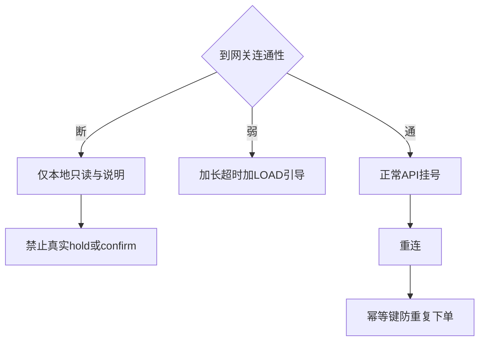

# 医鸿 IPTV 数字人 · 上线边界与运营治理补强

## 版本 v1.0 · 日期 2026-11-08

| 项 | 内容 |
|---|---|
| 定位 | 补齐方案疏漏：断网、到院付、绑码防刷、PII、遥控、多租户、SLA、LOAD 配置、控制面鉴权 |
| 适用 | Demo 可部分 Mock；试点/上线按「必做」执行 |
| 关联 | [00](./00-项目总方案-v1.2.md)、[02](./02-语音识别模块方案-v1.2.md)、[04](./04-挂号预约核心模块方案-v1.2.md)、[05](./05-数字人精灵图与动作方案-v1.3.md)、[06](./06-接口清单与数据契约-v1.2.md)、[08](./08-首次绑定人机与实验方案-v1.2.md)、[服务器方案](./服务器与网络建设方案/IPTV宽带电视-AI-API调用与容量调度方案-v1.2.md) |

### 命名消歧（必读）

| 名称 | 含义 | 勿与混淆 |
|---|---|---|
| `LOAD_L0`～`LOAD_L4` | 平台拥堵体验水位（远程配置） | 不是就诊人选择层级 |
| `PATIENT_L0/L1/L2` | 就诊人默认/语音/显式选择 | 见 04 |
| `INTERRUPT_L1` | 按键打断半双工 | 见 00/02 |

---

## 1. 断网 / 弱网边界

AI 上游忙时的「剧本引导」**不等于**家庭到网关断网仍能真实下单。



### 1.1 可本地做

| 能力 | 说明 |
|---|---|
| 静态 UI / 数字人资源 | 已缓存的精灵图、样式 |
| 危急 120 文案 | 本地规则，不依赖 LLM |
| 「我的预约」只读缓存 | 上次成功拉取的快照，标注「可能不是最新」 |
| 操作说明 / 帮助 | 本地文案 |
| 绑定页展示（未提交） | 可画 UI；**不可**确认落库 |

### 1.2 绝对禁止（断网或未确认连通时）

| 操作 | 原因 |
|---|---|
| `hold` / `confirm` | 真实号源与订单 |
| 绑定确认 / 客服代绑落库 | 身份变更 |
| 自动重放未完成的写请求 | 易重复挂号 |
| 假装「已挂号成功」 | 信任事故 |

### 1.3 弱网

- 加长超时；展示 LOAD 引导（见第 9 章）  
- 写操作失败：明确「没挂上」，给「重试 / 查我的预约 / 退出」  
- 禁止静默自动连打  

### 1.4 重连后防重复下单

1. 每个写操作使用 **操作级** `idempotencyKey`（hold 与 confirm **不得共用同一 key**）  
2. 断线前若已发出 confirm：重连后先 `GET` 订单/预约，再决定是否让用户确认重试  
3. UI 文案：「刚才可能已提交，请先查看我的预约，避免挂两次」  
4. 服务端：同一 idempotencyKey 返回同一结果，不新建第二单  

---

## 2. 支付边界：电视预约，到院缴费

### 2.1 定稿

对齐深圳市医院常见路径：**预约挂号与缴费可切割**。

| 环节 | 电视 IPTV | 医院现场 / 官方渠道 |
|---|---|---|
| 选科室/时段/就诊人/确认预约 | 做 | — |
| 预约凭证、取号提示、须知 | 做 | — |
| 挂号费 / 诊查费支付 | **不做** | 到院窗口、自助机、医院 App/公众号等（以医院当期规则为准） |
| 医保结算 | **不做** | 医院侧 |

电视闭环止于：**预约成功**（含取号码或预约单号、就诊须知）。凭证页明确写：「费用请到医院按规定缴纳」。

### 2.2 失败补偿（不含在线退款）

| 事件 | 处理 |
|---|---|
| 预占超时 | 自动释放；提示重新选时段 |
| 用户取消（规则允许窗口内） | `cancel`；凭证作废 |
| 停诊 / 改班 | 推送或下次开机提示；引导改约（接口见医院对接清单） |
| 支付失败 | 电视无支付态；不建扣款补偿 |

Demo/试点：Mock 预约成功即可；不实现支付状态机。

---

## 3. 绑定安全：防刷码 / 撞码

你提出的「输入与刷新限制」**可以解决大部分**暴力撞码；再叠加冻结与告警即可达 Demo/试点基线。若对抗脚本仍不够，启用进阶项。

### 3.1 必做（基线）

| 规则 | 建议阈值 |
|---|---|
| 手机端输错 6 位码 | 同码/同会话 ≥5 次错误 → 冻结 10～15 分钟，电视自动换新码 |
| 电视刷新绑定码 | 同设备最短间隔 30s；每小时 ≤10 次，超出进入冷却 |
| 确认成功 | 旧码立即作废；一码一设备会话 |
| 确认端 IP/账号 | 错误码限流（如 20 次/10 分钟） |
| 审计告警 | 短时大量失败 → 运维告警 |

### 3.2 进阶（可配置开关）

| 手段 | 作用 |
|---|---|
| 6 位 + 电视短挑战（颜色词/2 位图） | 提高枚举成本 |
| 临时升 8 位码 | 高峰或告警触发 |
| 家人勾选后，电视再按一次确认 | 证据链强于只勾选 |

### 3.3 家人同意证据

- 最低：勾选「已获本人同意」+ 审计  
- 推荐试点：电视端二次确认（见进阶）  

详情与人机流仍见 [08](./08-首次绑定人机与实验方案-v1.2.md)。

---

## 4. 医疗内容治理（Demo 延期）

| 项 | Demo | 试点前 |
|---|---|---|
| 广电三审 / 双人审 / 有效期 / 紧急下架 / 适用医院 | **不做** | 单独开专册后再做 |
| 当前 | 剧本标注「待医务科审核」即可 | — |

---

## 5. PII 字段白名单与日志

### 5.1 关注重点

1. ASR **原文默认是敏感个人信息**，不能当普通日志  
2. 「审计要留痕」≠「原文永久可查」  
3. 调试需要原文时：显式开关 + 短 TTL + 权限  

### 5.2 分类默认策略

| 存储 | 允许 | 禁止（默认） |
|---|---|---|
| 业务库 | 脱敏姓名、卡号后四、订单号、科室时段 | 身份证全码、完整诊断 |
| 遥测 telemetry | 事件名、耗时、variant、错误码、LOAD 水位 | ASR/LLM 原文、音频 |
| 审计 audit | operatorType、bindId、orderId、脱敏姓名、同意版本 | 原始语音、完整证件 |
| 调试 debug | 短时 ASR 文本（≤7 天或更短，可配） | 无权限账号访问 |

展示：字幕可显示当轮识别文字（会话内）；落盘走白名单。  
语音模块细则回写见 [02](./02-语音识别模块方案-v1.2.md)。

---

## 6. 遥控-only、无障碍与电脑验证

### 6.1 焦点与按键规范

| 项 | 约定 |
|---|---|
| 方向键 | 移动焦点 |
| 确认键 | 激活焦点；**在 IDLE 时直接进入说话/收音** |
| 返回键 | 上一步；顶层回首页 |
| 防抖 | 确认 300～500ms 内忽略连按 |
| 超时 | 无操作一段时间回首页或待机（可配） |

### 6.2 speak 模式

| 阶段 | 配置 |
|---|---|
| Demo | 默认 `speak.mode=text`（字幕） |
| 试点 | **字幕常驻 + 可选语音**（`browser_tts` 可开，建议默认开声可配置） |

### 6.3 电脑上如何验证遥控（不必接真 IPTV 盒）

**不需要**先把机顶盒专用蓝牙遥控绑到开发电脑才能做 Demo 验证。

| 方式 | 做法 | 推荐 |
|---|---|---|
| A 键盘映射 | 空格=确认，方向键=焦点，Esc=返回 | **默认** |
| B HID 蓝牙遥控 | 将通用蓝牙遥控与 Windows 配对（系统视为键盘），浏览器监听 `keydown`，记录键值表 | 想更像真遥控时 |
| C 真盒 | WebView/壳内收键值，见 07 | 跨端阶段 |

键值映射表放 `composables/useRemoteKeys.js`（见 01），便于以后换成盒端键码。

---

## 7. 多租户责任（RACI 与注意事项）

### 7.1 角色

| 角色 | 标识建议 |
|---|---|
| 医院 | `hospitalId` |
| 运营商（IPTV） | `operatorId` |
| 业务平台方 | `platform`（实现本系统） |
| AI 能力厂商 | `aiVendorId`（可多个） |
| 租户实例 | `tenantId`（常 = 医院×运营商组合或医院专区） |

所有业务写接口、配额、日志建议带 `tenantId`（Demo 可固定 `tenant_demo`）。

### 7.2 RACI 摘要（R=执行 A=问责 C=协商 I=知会）

| 事项 | 医院 | 运营商 | 平台 | AI 厂商 |
|---|---|---|---|---|
| 号源/停诊数据 | A/R | I | R（适配） | I |
| 就诊人实名合规 | A | C | R（展示脱敏） | I |
| 机顶盒账号/专网 | C | A/R | C | I |
| API 网关与配额 | C | C | A/R | C |
| AI Key 与出网 | C | C | A（可持钥） | R（服务） |
| 医疗话术审核 | A/R | I | C | I |
| 故障一线客服 | C | C | R（平台） | C |
| Token/调用费支付 | 合同约定 | 合同约定 | 计量提供 | 出账 |
| 日志与审计保管 | C | C | A/R | 按委托 |

### 7.3 注意事项清单

1. **密钥**：盒端不下发；按租户隔离；厂商 Key 与平台网关 Key 分离  
2. **配额**：按 `tenantId` 计量，避免一院打满拖垮全市  
3. **故障域**：单院配置错误不应影响其他租户  
4. **出网合规**：ASR/LLM 是否出医院域，合同写清；禁止默认用于训练  
5. **对账**：号源成功数 vs 平台订单数定期对账  
6. **客服入口**：电视「帮助」落到谁的热线，界面写死归属  
7. **变更**：路由/模型切换需租户级开关，禁止全局误切  
8. **退出**：解约后密钥作废、数据移交/删除策略  

---

## 8. 运维、SLA 与医院对接清单

### 8.1 SLO 初值（可调）

| 指标 | 初值建议 |
|---|---|
| 预约写操作成功率（非用户取消） | ≥ 99%（月） |
| 对话首字可感时延（P95，在线且非 LOAD_L3+） | ≤ 3s |
| 平台可用性（网关） | ≥ 99.5% |
| 降级率（进入 LOAD_L2+ 的会话占比） | 观测项，月报 |

### 8.2 RTO / RPO（初值）

| 项 | 初值 |
|---|---|
| RTO（网关故障恢复） | ≤ 30 分钟 |
| RPO（订单/绑定数据） | ≤ 5 分钟（视库备份） |
| 时钟 | 全链路 NTP；绑定码过期依赖可信时间 |

### 8.3 值班（前期 Mock）

Demo 使用本地 JSON，例如：

```json
{
  "shifts": [
    {
      "date": "2026-11-08",
      "role": "platform_oncall",
      "name": "演示值班A",
      "phoneTail": "1234",
      "escalation": "演示值班B"
    }
  ]
}
```

### 8.4 后续向医院要的真实数据 / API（你对接用）

请医院/信息科尽量提供（有则对接，无则 Mock 继续）：

| 类别 | 内容 |
|---|---|
| 字典 | 科室、医生、院区、就诊须知文案 |
| 号源 | 排班查询、余号、预占、确认、取消 |
| 变更 | 停诊/替诊推送或拉取 |
| 身份 | 就诊人校验（姓名+卡等最小字段）、家庭成员（若有） |
| 预约查询 | 按患者/订单查状态（防重复） |
| 客服 | 工单字段、转人工入口、值班联系人表（角色、时段、电话、升级人） |
| 合规 | 数据处理协议、出网限制、留存要求 |

**你对接后给我的形态**：OpenAPI/文档 + 测试环境地址 + 字段样例即可接入；本阶段继续 Mock。

---

## 9. 远程配置 `LOAD_L0`～`LOAD_L4` 详解

### 9.1 这是什么

控制面根据 AI/网关拥堵程度，向电视下发的 **体验水位包**：改话术、关闲聊、是否强制剧本等。  
**不是**就诊人 L0，也不是打断等级。

水位含义见 [服务器方案第 6 章](./服务器与网络建设方案/IPTV宽带电视-AI-API调用与容量调度方案-v1.2.md)（与本文一致用 `LOAD_*` 命名）。

### 9.2 如何解决「缺签名/灰度/回滚」

| 要素 | 方案 |
|---|---|
| 下发通道 | `GET /api/runtime-config` 或网关推送；带 `tenantId` |
| version | 单调递增；盒端只接受更新的 version |
| 签名 | HMAC/JWT；密钥仅服务端；盒端持公钥或共享密钥轮换 |
| 灰度 | `percent` 或设备尾号白名单 |
| 回滚 | 发布上一 version；或 `rollbackTo` |
| TTL | 配置过期时间；过期则拉新或用安全默认 |
| 离线默认 | 使用 **上次校验成功的配置**；若无缓存则 `LOAD_L0` |
| 旧盒兼容 | 忽略未知字段；必需字段有默认值 |
| 审计 | 谁在何时对何租户发布了何 version |

配置包示例字段：`loadLevel`、`disableChitchat`、`forceScript`、`subtitleOnly`、`promptKeys[]`、`version`、`expiresAt`、`signature`。

---

## 10. 控制面接口收紧

| 接口类型 | Demo | 生产 |
|---|---|---|
| `/api/providers/activate` | 开发者 Token 可调 | 运维角色 + 审计；可按租户禁用热切 |
| `/api/bind/variant` | 可调 | 仅实验租户开放 |
| telemetry / audit 导出 | 本地可导出 | **默认禁用**；需审批角色 |
| runtime-config 发布 | Mock | 双人/审批流（流程可后置，接口先鉴权） |

原则：**控制面 ≠ 公开业务 API**。详见 [06](./06-接口清单与数据契约-v1.2.md)。

---

## 11. 修订记录

| 版本 | 日期 | 说明 |
|---|---|---|
| v1.0 | 2026-11-08 | 首版：10 点疏漏定稿（断网、到院付、防刷、PII、遥控、RACI、SLA、LOAD、控制面；医疗三审延期） |
