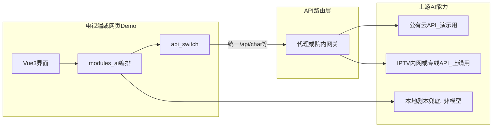
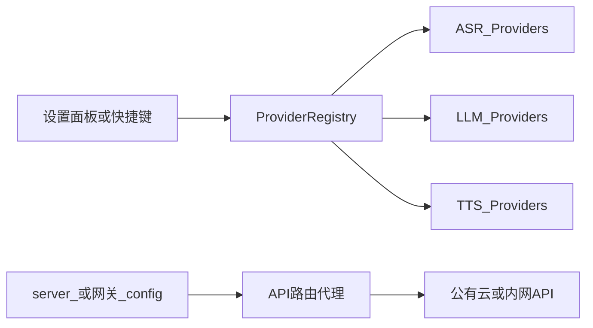

# 医鸿 IPTV 数字人 · AI 对话与 API 切换方案

## 版本 v1.1 · 日期 2026-11-08

| 项 | 内容 |
|---|---|
| 目标 | 接入 AI 处理对话；ASR/LLM/TTS 可独立切换并带内置调控 |
| 模块 | `src/modules/ai`、`src/modules/api-switch` + **服务端 API 路由代理** |
| 关联 | [00](./00-项目总方案-v1.1.md)、[02](./02-语音识别模块方案-v1.1.md)、[05](./05-数字人精灵图与动作方案-v1.2.md)、[06](./06-接口清单与数据契约-v1.1.md)、[07](./07-跨端迁移方案-v1.0.md) |
| 本版增量 | 明确：**前期不部署本地模型**；演示与 IPTV 内网均走 API 路由 |

---

## 1. 核心结论（先读这节）

| 问题 | 结论 |
|---|---|
| 前期要不要做「本地大模型 / 本地 ASR 模型模块」？ | **不需要** |
| 前期演示怎么接 AI？ | **API 路由**：前端只打自家 `/api/*`，由代理转发到云厂商或院内网关 |
| 后续 IPTV 正式部署怎么接 AI？ | **仍然是 API**：机顶盒/网页 → **IPTV/院内网关** → 内网或专线 AI 服务；盒子上不跑模型 |
| 方案里的 `modules/ai` 是什么？ | **编排与调用客户端**（组消息、流式解析、降级剧本），不是加载权重文件 |



**换环境只改代理上的 `baseUrl` / 路由表，不改挂号业务代码。**

规模化（千家万户、Token 配额、网关队列与 GPU/云算力调度）见专册：  
[服务器与网络建设方案/IPTV宽带电视-AI-API调用与容量调度方案-v1.1.md](./服务器与网络建设方案/IPTV宽带电视-AI-API调用与容量调度方案-v1.1.md)（含瓶颈时扩容与引导双轨）。

---

## 2. 设计原则

1. **API First**：AI 能力默认远程调用；不在 Demo 工程内嵌推理运行时（无 ONNX/GGUF/本地 GPU 模块）  
2. **业务不绑厂商**：只依赖 Provider 抽象与 HTTP 契约  
3. **Key 不出浏览器 / 不出机顶盒前端**：密钥只在代理或院内网关  
4. **失败可演示**：上游 API 挂了 → 医疗剧本；ASR 挂了 → mock  
5. **挂号不靠自由发挥**：槽位脚本优先；LLM 仅辅助闲聊/解释  
6. **安全在模型前**：危急词与禁答域硬编码拦截  

### 2.1 前期要做 / 不要做

| 要做 | 不要做 |
|---|---|
| Node（或院内）**API 路由代理** | 在前端或盒子里加载大模型权重 |
| `api-switch` 切换不同 `baseUrl` | 为演示单独做一套「本地模型模块」工程 |
| OpenAI 兼容优先 + 讯飞等适配器 | 业务代码直连各厂商 SDK |
| 剧本兜底 | 假定内网一定有 GPU 推理节点才能演示 |

---

## 3. 两阶段部署：同一套调用方式

### 3.1 阶段 A · 前期演示（你的电脑）

```text
浏览器 Vue3
  → http://127.0.0.1:xxxx/api/chat  |  /api/asr
  → 本地 Node 代理（读 config.json）
  → 公有云 API（DeepSeek / SenseVoice / 讯飞等）
```

- 切换厂商：改 `baseUrl` + `model` + Key，或面板 `activate`  
- 无 Key：走 `llm.script` / `asr.mock`，演示不中断  

### 3.2 阶段 B · IPTV 内网上线

```text
机顶盒 WebView / 网页
  → https://iptv-gateway.xxx/api/chat  |  /api/asr   （院内统一入口）
  → IPTV/医院 API 网关（鉴权、审计、限流）
  → 内网 AI 平台或专线厂商 API
```

| 点 | 约定 |
|---|---|
| 盒子侧 | **只当客户端**，不跑模型 |
| 网关 | 持有密钥、IP 白名单、日志脱敏 |
| 前端 | 仍只认识自家 `/api/*` 路径（可通过反代隐藏真实上游） |
| 切换 | 运维改网关路由或配置中心的 `baseUrl`，对应方案里的 Provider |

与阶段 A 的差异主要是 **代理部署位置与上游地址**，不是换一套「模型模块」架构。

### 3.3 配置如何表达「演示云」与「内网」

```json
{
  "llm": {
    "activeId": "llm.intranet",
    "providers": [
      {
        "id": "llm.demo_cloud",
        "label": "演示·公有云",
        "baseUrl": "https://api.deepseek.com/v1",
        "apiKey": "",
        "model": "deepseek-chat",
        "priority": 2
      },
      {
        "id": "llm.intranet",
        "label": "上线·IPTV内网网关",
        "baseUrl": "https://ai-gw.hospital.local/v1",
        "apiKey": "",
        "model": "hospital-chat",
        "priority": 1
      },
      {
        "id": "llm.script",
        "label": "剧本兜底",
        "priority": 99
      }
    ]
  }
}
```

演示机用 `llm.demo_cloud`；院内发布把 `activeId` 指到 `llm.intranet` 即可。

---

## 4. Provider 注册表（API 切换核心）



### 4.1 注册表示意

| 字段 | 说明 |
|---|---|
| `id` | 如 `llm.demo_cloud`、`llm.intranet`、`asr.xfyun` |
| `type` | `asr` / `llm` / `tts` |
| `baseUrl` | **路由目标**；演示与内网靠它区分 |
| `enabled` | 是否可选 |
| `priority` | 降级顺序 |
| `controls` | 超时、重试、温度等 |
| `adapter` | 服务端适配器名（OpenAI 兼容 / 讯飞等） |

### 4.2 运行时切换

| 方式 | 行为 |
|---|---|
| 改代理 `config.json` 后刷新 | 每次请求重读配置 |
| 前端设置面板 | `POST /api/providers/activate` |
| 运维网关 | 生产环境改路由，前端无感 |

切换后：进行中请求可 `abort`；下一轮用新 Provider；UI 显示当前 ASR/LLM/TTS 名称。

---

## 5. LLM 对话模块（调用侧，非模型侧）

`modules/ai` 职责：拼 messages、调 `/api/chat`、解析 SSE、失败降级剧本。  
**不包含**模型下载、量化、本地推理线程。

### 5.1 能力

| 能力 | Demo |
|---|---|
| 流式输出 | SSE；前端按句交给 speak 模块 |
| 上下文 | 最近 N 轮（建议 6 条） |
| System Prompt | 适老化、禁诊断、禁给药剂量、短句 |
| 中断 | 按键打断时 abort fetch |
| 降级 | HTTP 失败 → 意图剧本 |

### 5.2 与意图路由

```text
final 文本
  → safetyGuard（危急 / 禁答）
  → intentRouter
      ├─ registration_* → 槽位引擎（不走自由 LLM 编流程）
      ├─ 固定技能 → 审核过的剧本优先
      └─ chitchat / 未知 → 经 API 调 LLM，失败再剧本
```

### 5.3 默认调控

| 参数 | 默认 | 说明 |
|---|---|---|
| `temperature` | `0.6` | 医疗说明可降到 0.3 |
| `maxTokens` | `400` | 防止长篇大论 |
| `timeoutMs` | `15000` | 超时降级剧本 |
| `retry` | `1` | 仅网络错误重试 |
| `historyTurns` | `6` | 上下文条数 |

---

## 6. 说话输出与口型（先文字，后 TTS API）

统一 `avatar/speak.speak(text)`（见 [05](./05-数字人精灵图与动作方案-v1.2.md)）。

| speak.mode | 说明 |
|---|---|
| `text` | 前期默认，不出声 |
| `browser_tts` | 本机朗读 |
| `cloud_tts` | 同样走 API 路由到 TTS 服务（演示云或内网） |

---

## 7. 内置调控面板（测试用）

| 调控项 | 作用 |
|---|---|
| ASR / LLM / TTS Provider | 含「演示云 / 内网网关 / mock」 |
| temperature / maxTokens | 下一轮生效 |
| 降级顺序 | priority |
| 强制剧本 | 忽略 LLM |
| 超时 ms | 模拟慢网或内网延迟 |

老人主界面隐藏；开发者模式打开。

---

## 8. 安全规则（AI 侧）

| 规则 | 处理 |
|---|---|
| 胸痛、喘不上气、呕血、说不出话、自伤等 | EMERGENCY，播 120，不挂号 |
| 诊断、给药剂量、承诺疗效 | 拒答 |
| 输出标识 | 常驻「AI 生成，仅供参考」 |
| 内网审计 | 网关侧记调用方、耗时、脱敏入参（上线） |

---

## 9. 配置文件形状（服务端 / 网关）

见 §3.3；前端 `GET /api/config` **剥离 apiKey**，只返回可用性与展示名。

---

## 10. 验收用例

| 编号 | 场景 | 期望 |
|---|---|---|
| A1 | 演示云 Key 有效 | 经 `/api/chat` 流式回答 |
| A2 | Key 无效 | 降级剧本，演示不中断 |
| A3 | activeId 切到 intranet 配置 | 请求打到内网 baseUrl（可用 mock 网关验证） |
| A4 | 工程内无本地模型目录 | 仍能完整演示 |
| A5 | 强制剧本 | 挂号流程完整 |
| A6 | 危急词 | 不经过 LLM |
| A7 | 打断 | abort 上游 API 请求 |

---

## 11. 修订记录

| 版本 | 日期 | 说明 |
|---|---|---|
| v1.0 | 2026-11-08 | 首版：注册表、调控、安全边界 |
| v1.1 | 2026-11-08 | API First；明确不建本地模型模块；演示云与 IPTV 内网同构路由 |
