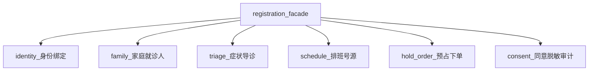

# 医鸿 IPTV 数字人 · 挂号预约核心模块方案

## 版本 v1.1 · 日期 2026-11-08

| 项 | 内容 |
|---|---|
| 定位 | **项目核心业务模块**；须可按子模块独立优化与替换 |
| 路径 | `src/modules/registration/*` |
| 视觉依据 | 交付包 `02-交互视觉稿` S1–S7 |
| 业务依据 | 交付包《IPTV数字人挂号预约-能力打通与自建设计-v0.3》 |
| 关联 | [00 总方案](./00-项目总方案-v1.1.md)、[01 工程规范](./01-目录与工程规范-v1.0.md)、[06 接口](./06-接口清单与数据契约-v1.1.md)、[08 绑定人机](./08-首次绑定人机与实验方案-v1.1.md) |
| 本版增量 | identity/consent 收束；绑前同意时序写死；绑定细节外置到 08 |

---

## 1. 模块目标

在电视大屏场景下，用语音 + 大字 UI 帮老人完成：

**绑定（首次）→ 识别就诊人 → 说症状导诊 → 选时段 → 确认 → 拿到取号码**。

Demo 阶段采用路径 **C（导诊 + Mock 号源/凭证）**，接口形状按终态路径 **B（预约中台）** 设计，便于以后只替换 `hold-order` / `schedule` 适配器而不改 UI。

首次绑定的人机细节、三流对比与采集指标见专册：[08-首次绑定人机与实验方案-v1.1.md](./08-首次绑定人机与实验方案-v1.1.md)。本文件只保留模块边界与摘要，避免再次零散堆叠。

---

## 2. 子模块分类（独立优化边界）



| 子模块 | 目录 | 输入 | 输出 | 可替换点 |
|---|---|---|---|---|
| 身份绑定 | `identity/` | 设备 ID、`bindFlowVariant` | 绑定会话、设备 Token | 公众号 / 运营商账号；人机流 A/B/C |
| 家庭就诊人 | `family/` | 家庭账户 | 当前就诊人、成员列表 | 家庭账户服务 |
| 症状导诊 | `triage/` | 用户话语 | 科室推荐、槽位状态 | 知识库与规则引擎 |
| 排班号源 | `schedule/` | 科室/日期 | 最多 3 个候选时段 | 预约平台 Adapter |
| 预占下单 | `hold-order/` | 候选 + 就诊人 | holdId、订单、凭证 | 真锁号与订单中心 |
| 同意与隐私 | `consent/` | 用户确认 | 同意记录、脱敏视图、审计 | 合规策略 |

**硬规则**：其它模块（voice/ai/avatar）禁止直接调用子模块内部文件，只通过 `registration/index.js` 门面。

---

## 3. 端到端流程（对齐 S1–S7）

```text
[S1 首页] 看病挂号 / 语音「我要挂号」
    ↓
[是否已绑定？] 否 → [明示同意] → [S7 首次绑定·按 variant A/B/C] → 轮询至 BOUND
    ↓ 是
[解析就诊人] L0 默认当前人 / L1 语音切换 / L2 打开 [S4 选就诊人]
    ↓
[S2 说症状] 每轮一问，槽位面板点亮；危急词则退出挂号进 EMERGENCY
    ↓
[科室匹配] triage 输出 departmentId
    ↓
[S3 选时段] schedule 压缩为 ≤3 候选；语音「第一个」或焦点确认
    ↓
[预占] hold 90–120 秒
    ↓
[S5 确认挂号] 复述：就诊人 + 科室 + 医生 + 时间；说「对」或按确认
    ↓
[幂等下单] confirm
    ↓
[S6 挂号成功] 大号取号码 + 二维码区 + 须知；30 分钟内可取消（Demo Mock）
```

### 3.1 流程状态机

| 状态 | 画面 | 允许的用户动作 |
|---|---|---|
| `HOME` | S1 | 进挂号、进绑定、闲聊 |
| `CONSENT` | 同意页 | 同意 / 取消（**出码前必经**） |
| `BINDING` | S7（A/B/C 变体） | 扫码/念码/帮助；再读一遍 |
| `TRIAGE` | S2 | 回答症状、打断、退出 |
| `PICK_SLOT` | S3 | 选 1/2/3、返回改症状 |
| `PICK_PATIENT` | S4 | 选成员、添加（Demo 可灰） |
| `HOLDING` | 过渡 | 等待 hold 结果 |
| `CONFIRM` | S5 | 确认 / 否定 / 超时释放 |
| `SUCCESS` | S6 | 完成、取消、回首页 |
| `BLOCKED_EMERGENCY` | 红屏 | 仅结束指引（策略见总方案） |

---

## 4. 子模块详细设计

### 4.1 identity · 身份绑定（摘要）

**难点**：电视无输入法、IPTV 账号不等于患者；老人举机扫码受手抖/眩光/老花影响大。

**本模块只负责**：创建/轮询绑定会话、下发 Token、按 `bindFlowVariant` 驱动 UI 状态；不在此重复长篇话术。

| 项 | Demo 约定 |
|---|---|
| 实验流 | `A` 同屏双通道 · `B` 先分流 · `C` 家人代办优先 |
| 码与二维码 | **同源**；短链降密度；有效期 5 分钟 |
| 6 位码展示 | **3+3** 分块；支持「再说一遍」 |
| 轮询 | 2 秒 |
| 状态机 | `PENDING → SCANNED → CONFIRMED → BOUND`（或 `EXPIRED`） |
| 成功后 | `deviceSessionToken`；存储方案见跨端文档（Demo 可 sessionStorage 并标注风险） |
| 客服 | 帮助键 / 语音「找人帮我」→ Mock 代绑 |

人机逐步话术、手机 H5、失败分支、生理依据、实验指标：**全部见 [08](./08-首次绑定人机与实验方案-v1.1.md)**。

### 4.2 family · 家庭就诊人

三层策略（沿用交付包 v0.3）：

| 层 | 占比预期 | 行为 |
|---|---|---|
| L0 | ~70% | 默认当前就诊人，不弹窗 |
| L1 | ~25% | 语音「给老伴挂」→ 解析称谓映射 |
| L2 | ~5% | 打开 S4 2×2 大卡选择器 |

切换就诊人后必须重校验：

- 性别 vs 妇产科  
- 年龄 vs 儿科  
- 初诊/复诊限制（Demo 可简化规则表）  
- 特殊号源（孕产等）Mock 标记  

代挂：审计日志记录 **操作者（设备/家庭管理员）** 与 **就诊人**；跨家庭取号拒绝。

### 4.3 triage · 症状导诊

| 规则 | 说明 |
|---|---|
| 每轮一问 | 部位 → 时长 → 伴随症状… |
| 槽位面板 | 右侧「我已经了解」逐条点亮（对齐 S2） |
| 知识库 | Demo 内置 30–50 条症状→科室；标注「待医务科审核」 |
| 危急 | 命中则中止挂号，转安全模块 |
| 与 LLM | 可用 LLM 帮助理解口语，但 **最终科室必须落在白名单映射**，禁止模型直接发明科室 |

### 4.4 schedule · 排班号源

| 能力 | Demo |
|---|---|
| 查询 | Mock：若干科室 × 3 天 × 上午/下午 |
| 压缩 | 只展示最多 3 个候选，含余号 |
| 缓存 | 内存；TTL 30s |
| 停诊 | 可选 Mock 一条「停诊」演示改期文案 |

### 4.5 hold-order · 预占与下单

| 步骤 | 参数 | 说明 |
|---|---|---|
| hold | `slotId`, `patientId`, `idempotencyKey`, `ttlSec=120` | 预占失败明确语音说明 |
| confirm | `holdId`, `idempotencyKey` | 同一 key 重复提交返回同一订单 |
| cancel | `orderId` | 30 分钟内可取消（Demo） |

过期：CONFIRM 页倒计时；超时释放号源，回到 PICK_SLOT。

### 4.6 consent · 加密、安全、隐私、适老化

本子模块是需求「加密、安全、隐私、方便老年用户」的集中落点。

#### 4.6.1 同意时序（v1.1 写死）

```text
进入绑定 / 首次挂号需要身份
  → CONSENT（大字 + 语音明示）
  → 用户同意
  → 才允许 createBindSession 出码
禁止：先出码后补同意
```

家人协助路径（流 B-Family / 流 C）在同意文案中须包含「可让家人协助；家人确认时声明已获本人同意」。

#### 4.6.2 隐私与同意

| 能力 | Demo 体现 |
|---|---|
| 明示同意 | 绑前大字条款 + 语音 + 「同意」 |
| 最小必要 | 接口只取姓名、性别、年龄段、就诊卡脱敏号 |
| 脱敏展示 | `张*兰`、卡号 `****1234`；禁止展示身份证全码 |
| 解绑 / 撤回 | 设置页提供「解除绑定」（Mock） |
| 代办追溯 | `operatorType`: self / family / agent |
| 审计 | `consent.accepted`、`bind.*`、`patient.switched`、`order.confirmed`；留存策略标注 ≥6 个月 |

#### 4.6.3 安全与加密（Demo 可演示级别）

| 能力 | Demo | 后续生产 |
|---|---|---|
| 传输 | localhost；文档要求上线 HTTPS | TLS / 院内网关 |
| 密钥 | API Key 仅服务端 | KMS、轮换 |
| 会话 | `deviceSessionToken` + 过期时间 | 刷新令牌、撤销列表 |
| 绑定码 | 短时、单次设备绑定会话 | 防撞库与频控 |
| 完整性 | 写操作带 `idempotencyKey` | 签名与防重放窗口 |
| 限频 | 同设备 hold/confirm 限流 | WAF / 网关 |
| 字段保护 | 响应侧脱敏；日志脱敏 | 字段级加密 |
| 权限 | 订单必须属于当前家庭账户 | RBAC |

#### 4.6.4 适老化（方便老人）

| 能力 | 体现 |
|---|---|
| 大字高对比 | 正文 ≥32px，取号码 ≥96px |
| 每轮一问 | triage 强制；绑定亦一步一事 |
| 复述确认 | S5 必念全名与时间 |
| 少选项 | 时段最多 3 个；成员 2×2；绑定用 A/B/C 验证是否同屏双入口 |
| 双通道操作 | 语音「对/第一个」+ 遥控器焦点 |
| 失败转按键 | 识别两次失败弹出大按钮菜单 |
| 语速 | TTS 0.85–0.88；读码更慢 |
| 子女代劳 | 数字码 / 客服；见 08 |

---

## 5. 门面 API（供编排层调用）

```js
// registration/index.js 对外契约（实现阶段按此落地）

/** 进入挂号；自动判断是否需要绑定 */
export async function startRegistrationFlow(sessionCtx) {}

/**
 * 绑定会话。
 * @param {{ variant: 'A'|'B'|'C' }} options 人机实验流，详见文档 08
 */
export async function createBindSession(options) {}
export async function getBindSession(bindId) {}
export async function mockBindConfirm(bindId) {}

/** 就诊人 */
export function getCurrentPatient() {}
export function listFamilyPatients() {}
export function setCurrentPatient(patientId, reason) {}

/** 导诊 */
export function resetTriage() {}
export function applyTriageUtterance(text, confidence) {}
export function getTriageSnapshot() {}

/** 号源与订单 */
export async function querySlotCandidates(departmentId) {}
export async function holdSlot(input) {}
export async function confirmOrder(input) {}
export async function cancelOrder(orderId) {}

/** 同意与审计：同意必须在出码前调用成功 */
export async function acceptConsent(version) {}
export function maskPatient(patient) {}
export function appendAudit(event) {}
```

---

## 6. 数据实体（Demo）

| 实体 | 关键字段 |
|---|---|
| DeviceSession | `deviceId`, `token`, `expiresAt`, `familyId` |
| BindSession | `bindId`, `code6`, `qrPayload`, `variant`, `status`, `expiresAt` |
| Patient | `id`, `displayName`, `relation`, `sex`, `age`, `cardTail` |
| TriageSlot | `symptom`, `bodyPart`, `duration`, `departmentId` |
| SlotCandidate | `slotId`, `dept`, `doctor`, `timeText`, `remain` |
| Hold | `holdId`, `expireAt`, `slotId`, `patientId` |
| Order | `orderId`, `ticketNo`, `qrPayload`, `status` |
| AuditEvent | `ts`, `type`, `actor`, `operatorType`, `patientId`, `meta` |
| ConsentRecord | `version`, `acceptedAt`, `deviceId` |
| BindTelemetry | 见 08 / 06，不含身份证明文 |

---

## 7. 与对话编排的协作

| 意图/事件 | 挂号模块行为 |
|---|---|
| `intent.registration` | `startRegistrationFlow` |
| triage 中的 final 文本 | `applyTriageUtterance`（先过 safety） |
| 「第一个/第二个」 | 映射候选索引 |
| 「对 / 不对」 | confirm 或回退 |
| 「给老伴挂」 | `setCurrentPatient` + 号源重校验 |
| 「再说一遍」 | 绑定态重读 6 位码（3+3） |
| 「找人帮我」 | 进入客服代绑说明 |
| 危急命中 | 取消 hold（若有）并退出流程 |

**禁止**：LLM 直接调用 `confirmOrder`。确认必须来自用户明确语音或按键。

---

## 8. Demo 验收清单（核心）

| 编号 | 场景 | 期望 |
|---|---|---|
| R1 | 未绑定进挂号 | 先同意，再按 variant 进入 S7 |
| R1b | 未同意 | 不能出码 |
| R2 | 模拟扫码/输码 | 状态到 BOUND，回首页显示当前人 |
| R2b | 切换 A/B/C | UI 与埋点 variant 一致 |
| R3 | 默认就诊人挂号 | 不弹 S4，走完 S2→S3→S5→S6 |
| R4 | 语音换就诊人 | 审计有切换记录；确认卡姓名正确 |
| R5 | 打开成员选择器 | 2×2 大卡，焦点清晰 |
| R6 | 预占超时 | 提示并回选时段 |
| R7 | 重复确认同一幂等键 | 不产生第二笔订单 |
| R8 | 页面展示 | 无身份证全码；卡号脱敏 |
| R9 | 胸痛 | 不产生订单，进急救 |
| R10 | 两次听不清 | 出现大按钮「选时段/退出」 |

绑定人机细则验收见 08 第 13 章。

---

## 9. 后续模块级优化建议

| 优先级 | 优化 | 动哪个子目录 |
|---|---|---|
| 高 | 医务科审核导诊知识库 | `triage/` |
| 高 | 接统一预约平台 | `schedule/` + `hold-order/` |
| 高 | 根据 A/B/C 数据选定默认绑定流 | `identity/` + 08 |
| 中 | 真扫码绑定 / 真公众号 | `identity/` |
| 中 | 家庭账户云端化 | `family/` |
| 中 | 审计与同意合规加固 | `consent/` |
| 低 | 支付 / 医保 | 新建 `payment/`（本版不建） |

---

## 10. 修订记录

| 版本 | 日期 | 说明 |
|---|---|---|
| v1.0 | 2026-11-08 | 首版：六子模块拆分、S1–S7 状态机、安全隐私适老化、门面 API |
| v1.1 | 2026-11-08 | identity 摘要化并指向 08；CONSENT 状态；绑前同意时序；variant 字段 |
