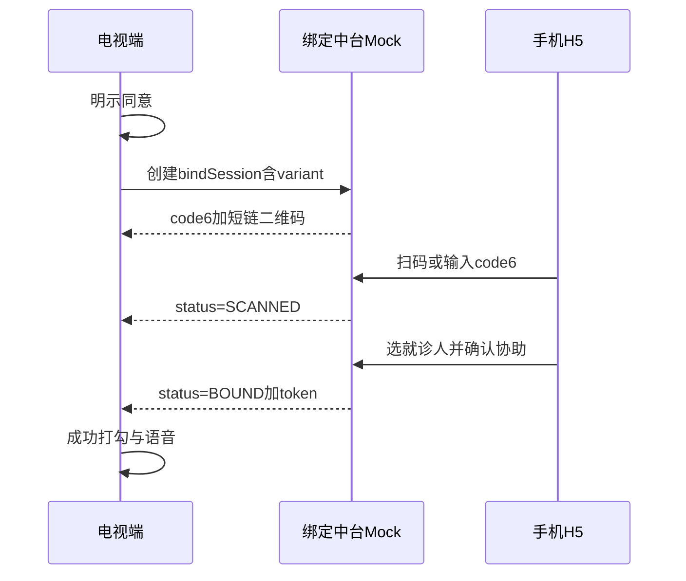
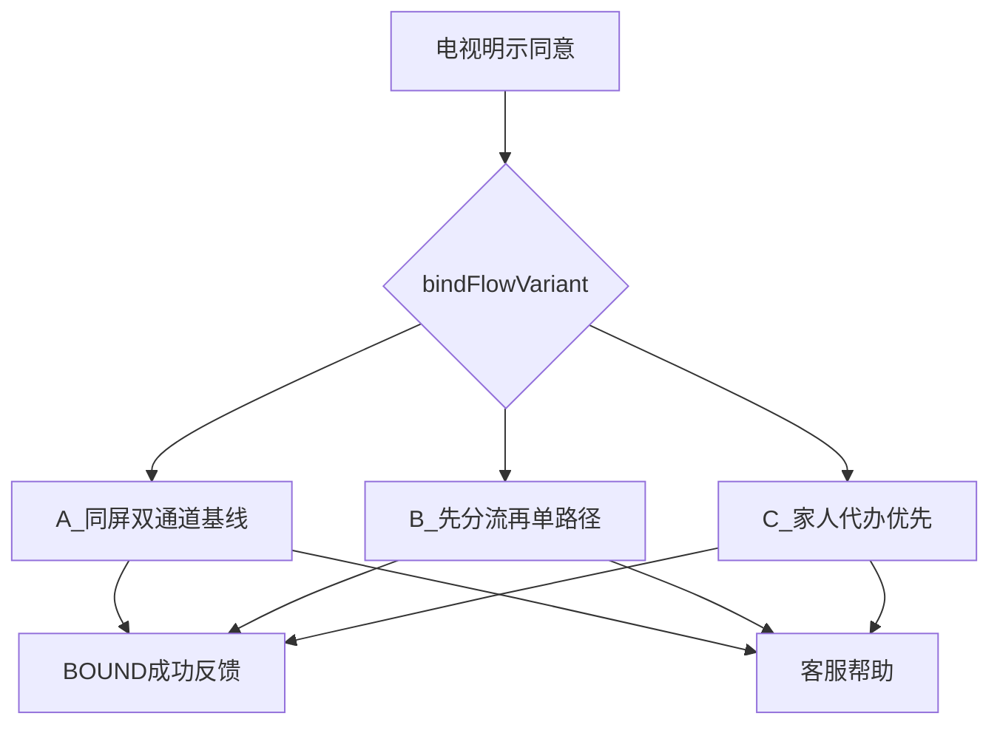

# 医鸿 IPTV 数字人 · 首次绑定人机与实验方案

## 版本 v1.1 · 日期 2026-11-08

| 项 | 内容 |
|---|---|
| 定位 | 把 S7「扫码 + 数字码 + 客服」从零散能力，收成可演示、可对比、可采集的人机方案 |
| 视觉依据 | [`S7-首次绑定.png`](../医鸿IPTV数字人-交付包/02-交互视觉稿/S7-首次绑定.png) |
| 业务依据 | 交付包挂号方案 v0.3 第 9 章身份体系 |
| 模块落点 | `registration/identity` + `registration/consent`；实验开关在设置面板 |
| 关联 | [00 总方案](./00-项目总方案-v1.1.md)、[04 挂号核心](./04-挂号预约核心模块方案-v1.1.md)、[06 接口](./06-接口清单与数据契约-v1.1.md)、[05 数字人](./05-数字人精灵图与动作方案-v1.2.md) |

---

## 1. 为什么单独成册

v1.0 在 [`04`](./04-挂号预约核心模块方案-v1.1.md) 里只写了「同屏三入口」，现场演示时会出现：

- 老人不知道先看左边还是右边（选择过载）
- 自己举手机扫电视码经常失败（手抖、眩光、老花）
- 数字码不会念、念太快、念错位（工作记忆与口语节奏）
- 家人代办时，老人并未真正知情同意（隐私缺口）
- 无法回答「到底哪种流程更好」

本册固定 **3 条实验流 A/B/C**，共用同一套后端与隐私规则，只改人机路径，便于你在实际演示中切换并采集手机侧数据。

---

## 2. 设计宗旨与硬约束

**宗旨**：在保证隐私的前提下，尽量让用户用起来更简单、更稳、更能完成。

| 硬约束 | 说明 |
|---|---|
| 绑前同意 | 进入任何扫码/输码之前，电视必须完成大字 + 语音明示同意 |
| 最小必要 | 电视与手机均不展示身份证全码；确认页只用脱敏姓名 |
| 短时绑定码 | 6 位码与二维码同源，默认 5 分钟，过期自动换新 |
| 可解绑 | 成功页与设置页均可找到「解除绑定」入口说明 |
| 代办可追溯 | 操作者类型：`self` / `family` / `agent`；家人须勾选「已获本人同意协助」 |
| 一步一事 | 同一时刻只强调一个主动作，避免长文说明书 |

---

## 3. 老年生理与认知依据（设计基线）

以下不是口号，而是每条交互决策的依据。

| 维度 | 常见老化变化 | 对绑定设计的含义 |
|---|---|---|
| 视觉 | 老花、对比敏感度下降、眩光敏感、暗适应变慢 | 码区超大高对比；二维码必须短链降密度；电视亮屏下手机摄像头易失败 → **不能只押扫码** |
| 运动 | 手抖、握持不稳、精细动作变慢 | 「举起手机对准电视」成本高；优先坐着念数字，或子女到场代扫 |
| 工作记忆 / 双任务 | 边看说明边操作能力下降 | 禁止长教程；一步一事；6 位码按 **3+3** 分块显示与朗读 |
| 决策负荷 | 选项越多越慢（希克定律） | 用实验流对比「同屏双入口」vs「先问一句再单路径」 |
| 听力与口语 | 语速偏好变慢、易漏听 | 数字人慢速逐位播报；提供「再说一遍」 |
| 信任与恐惧 | 怕被骗、怕绑错人、怕泄露 | 绑前说清「只关联这台电视、可解绑」；确认页脱敏 |

### 3.1 为什么 6 位码要 3+3

- 连续 6 位接近老年双任务下的工作记忆负担上限  
- 显示为 `482 917`，朗读为「482，停顿，917」  
- 降低念错、听错、输错；埋点统计「再说一遍」与输错次数  

### 3.2 为什么扫码常常失败（手机侧现实）

| 现象 | 可能原因 | 产品对策 |
|---|---|---|
| 对不准 / 对上了不认 | 手抖、距离、屏幕反光、码过密 | 短链大码；失败 2 次转家人路径；允许子女代扫 |
| 找不到「扫一扫」 | 微信版本/入口不熟 | 流 B 用三步大图；流 C 默认不要求老人操作手机 |
| 扫完不知道点哪里 | 手机页信息过载 | H5 每屏只做一件事：选人 → 勾选 → 确认 |
| 老人独自在家 | 无子女在场 | 电话念码；或客服代绑兜底 |

---

## 4. 共用状态机与时序

```text
UNBOUND
  → CONSENT_REQUIRED（电视明示同意）
  → PENDING（已创建 bindSession，展示码）
  → SCANNED（手机已打开落地页 / 已提交 code）
  → CONFIRMED（手机选定就诊人并确认）
  → BOUND（电视落库 deviceToken，成功反馈）
旁路：EXPIRED / CANCELLED / FAILED → 刷新码或转客服
BOUND → UNBOUND（解绑）
```



| 参数 | Demo 默认 |
|---|---|
| 码有效期 | 5 分钟 |
| 电视轮询 | 2 秒 |
| 过期策略 | 自动换新码并语音提示「我帮您换了个新码」 |
| 短链形态 | `https://hosp.example/b/{shortId}`（Demo 可用 mock 短链） |

---

## 5. 三条实验流（现场可切换）

设置项：`bindFlowVariant = A | B | C`。  
三条流 **后端契约相同**，仅引导与信息架构不同。



---

### 5.1 实验流 A · 同屏双通道（基线，对齐 S7）

**假设**：信息一次给全，老人或家人自己选通道，覆盖面最大。

**电视布局**（对齐视觉稿）：

1. 标题：「绑定就诊人，只需一次」  
2. 副标题：「绑定以后，开机就能直接挂号，不用再认一遍」  
3. 左：大二维码 +「微信扫一扫」  
4. 右：6 位码分块 +「或者，让家人输入这 6 个数字」+ 5 分钟有效说明  
5. 底：「按【帮助】键，可以找客服帮您绑定」  

**数字人话术（开场，只说一遍主信息）**：

> 绑定以后就不用再认了。您可以用微信扫左边的码；如果您不方便，就让家人输入右边这六个数字。需要帮助，请按帮助键。

**优点**：与现有视觉稿一致；家喻户晓的「双通道」。  
**风险**：选择犹豫；左右同时抢注意力；独自老人可能两头都做不好。  
**适用**：作为对照基线，测量真实完成率。

**失败处理**：

| 情况 | 电视反应 |
|---|---|
| 码过期 | 自动刷新 +「码过期了，我换了个新的」 |
| 60 秒无进展 | 轻提示：「可以让家人帮忙输入数字」 |
| 120 秒仍无进展 | 高亮帮助入口 |
| 用户说「找人帮我」 | 进入客服说明页 |

---

### 5.2 实验流 B · 先问一句，再进单路径（降选择负荷）

**假设**：先减少选项，比同屏双入口更快完成；扫码失败可转交家人。

**步骤 B0 · 同意后只问一句**

电视大按钮二选一（也可语音回答）：

- 「我自己用手机」  
- 「请家人帮忙」  

话术：

> 我们绑定一次就好。您是自己用手机，还是请家人帮忙？

**步骤 B1-Self · 自己用手机**

- 屏幕 **只放大二维码**（数字码收起到次级「显示数字码」）  
- 右侧或下方三步大图（每步不超过 8 字）：  
  1. 打开微信  
  2. 对准电视上的码  
  3. 在手机上点确认  
- 附加生理补偿提示（小字或语音一次）：「坐着举机，双手更稳；离电视远一点，避免反光」  

失败策略：

- 识别到用户反复进出/口头「扫不上」或演示员点「扫码失败」≥2 次 → 自动建议切到「请家人帮忙」  
- 埋点：`qr_fail_count`

**步骤 B1-Family · 请家人帮忙**

- 屏幕 **只放大 6 位码（3+3）**  
- 数字人逐位慢读：先读前三位，停顿，再读后三位  
- 常驻按钮：「再说一遍」  
- 说明：「请家人在手机绑定页输入这些数字；您不用操作手机」  

**步骤 B2 · 客服**

任一子路径底部保留帮助键。

**优点**：符合「一步一事」与希克定律；为手抖用户准备退路。  
**风险**：多一跳提问；若提问本身听不懂，需大按钮兜底。  

---

### 5.3 实验流 C · 家人代办优先（默认不抢老人精细动作）

**假设**：老年精细动作与摄像头对准是主摩擦；念数字给子女是更稳的主路径。

**默认屏**：

- 主视觉只有 6 位码（3+3）+ 倒计时  
- 话术：  

> 请把这六个数字告诉家人。家人在手机上确认后，电视会自动好。我读一遍：482……917。需要我再读，就说再说一遍。

- 次级入口（较低视觉权重）：「我要自己扫码」→ 展开二维码全屏/半屏  
- 帮助键仍在  

**手机 H5（家人）** 必须多一步勾选：

- 「我是家人，已获得本人同意，协助绑定到这台电视」  

未勾选不可确认（隐私）。

**优点**：降低老人独自操作手机的概率；电话远程子女也可完成。  
**风险**：无家人且不会打电话时依赖客服；自己想扫码的用户多点一次。  
**预期**：子女在场或电话远程场景完成率、安心分更高。

---

## 6. 电视明示同意（三流共用，绑前必做）

**必须先于出码。** 内容用大字 + 数字人朗读，用户说「同意」或按确认。

建议朗读稿（可拆两句）：

> 为了在这台电视上帮您挂号，需要把您的就诊人信息关联到这台电视。我们只使用挂号必需的信息，不会在电视上显示完整身份证号。您以后可以解除绑定。您是否同意？

同意事件：`consent.accepted`（含 `version`、`variant` 将在出码后一并记入会话）。

若用户选「家人协助」类路径（B-Family / C 默认），同意文案追加一句：

> 您也可以让家人帮您完成绑定；家人确认时需要声明已获得您的同意。

---

## 7. 手机 H5 流程（三流复用）

Demo 可用独立路由页（如 `/m/bind`），每屏一事。

| 步骤 | 页面 | 规则 |
|---|---|---|
| M1 | 进入（扫码落地或手输 6 位） | 码错/过期明确中文错误，可返回重试 |
| M2 | 确认设备 | 显示「客厅电视」类昵称，不显示家庭地址详情 |
| M3 | 选择就诊人 | 列表脱敏姓名；禁止新建时要求身份证全码（Demo 用已有 Mock 成员） |
| M4 | 授权确认 | 最小必要说明 + 家人勾选（若 `operatorType=family`） |
| M5 | 成功 | 「请看电视，已绑定成功」；电视应在 2 秒轮询内切换 |

禁止：在 H5 堆叠广告、多余菜单、一次填写大量表单。

---

## 8. 客服代绑（三流共用兜底）

触发：帮助键 / 语音「找人帮我」/ 流 B/C 超时策略。

Demo 表现：

1. 电视显示大字：「请稍等，客服可以帮您绑定」+ 模拟工单号  
2. 开发者面板可点「客服已代绑成功」调用 Mock 接口  
3. 审计：`operatorType=agent` + `operatorId`

生产对接见交付包 C1；本 Demo 只验证体验闭环。

---

## 9. 成功反馈（三流共用）

进入 `BOUND` 后：

1. 全屏打勾  
2. 语音：「绑定成功，以后不用再绑了。」  
3. 展示当前就诊人脱敏姓名  
4. 主按钮：「去挂号」；次按钮：「完成」回首页  
5. 埋点：`bind_success`（含 variant、path、durationMs）

---

## 10. 数字人在绑定态的行为

| 阶段 | 动作建议 | 语速 |
|---|---|---|
| 同意 | `speak`，关切表情 | 0.85 |
| 出码等待 | `idle` 轻动作，不抢戏 | — |
| 逐位读码 | `speak`，可轻微指向码区（若有手势帧） | 更慢，位间停顿 |
| 成功 | `smile` + 短祝福句 | 正常偏慢 |
| 失败安抚 | `speak`，避免 alert 恐吓感 | 0.85 |

详情动作与说话模块见 [05](./05-数字人精灵图与动作方案-v1.2.md)；绑定页以字幕可读为第一优先级（speak.mode 可先用 text）。

---

## 11. 实验指标与采集（回答哪种更好）

### 11.1 必采指标

| 指标 | 定义 |
|---|---|
| 完成率 | 进入同意页 → `BOUND` |
| 中位耗时 | 同意完成 → `BOUND`（毫秒） |
| 路径占比 | `qr` / `code6` / `help` |
| 失败次数 | 扫码失败、码过期、输错 code |
| 求助率 | 触发帮助/客服 |
| 再读次数 | 「再说一遍」点击/语音次数（B/C） |
| 分流选择 | 流 B：`self` vs `family` |
| 场景角色 | `elder_alone` / `family_onsite` / `family_phone` |
| 主观简单分 | 1–5（结束后口头或平板点选） |
| 主观安心分 | 1–5（隐私是否放心） |

### 11.2 事件名（写入 telemetry）

`bind_consent_show`、`bind_consent_accept`、`bind_session_create`、`bind_path_select`、`bind_qr_shown`、`bind_code_shown`、`bind_code_reread`、`bind_qr_fail`、`bind_expired`、`bind_help`、`bind_phone_scanned`、`bind_phone_confirm`、`bind_success`、`bind_abort`、`bind_subjective_score`

### 11.3 现场演示建议

| 场次 | 建议 |
|---|---|
| 每流至少 | 5 位目标用户或 5 组「老人+子女」 |
| 控制变量 | 同一房间光线、同一部测试机、同一套话术培训 |
| 记录 | 自动 JSONL + 观察员笔记（是否手抖、是否戴老花镜、是否电话协助） |
| 决策 | 优先看完成率与安心分；耗时次之；再看求助率 |

### 11.4 如何解读（预置假设，用数据证伪）

| 若出现 | 可能结论 |
|---|---|
| A 完成率低、耗时高、左右徘徊 | 同屏双入口选择过载，倾向 B/C |
| B-self 扫码失败高但转 family 后成功 | 保留扫码，但必须有失败转交 |
| C 安心分与完成率双高 | 家人代办优先可作为默认上线策略 |
| C 在「老人坚持自己扫」人群抱怨多 | 默认 C，但「自己扫码」入口要够明显 |

---

## 12. 与模块 / 接口的落点

| 能力 | 位置 |
|---|---|
| variant 切换 | 设置面板 + `POST /api/bind/sessions` 带 `variant` |
| 同意 | `consent` 子模块，绑前拦截 |
| 读码 / 再读 | TV 绑定页 + avatar TTS |
| 手机确认 | `POST /api/bind/confirm` |
| 客服代绑 | `POST /api/agent/bind` |
| 埋点 | `POST /api/telemetry/bind` |

接口细节见 [06](./06-接口清单与数据契约-v1.1.md)。

---

## 13. 验收清单

| 编号 | 场景 | 期望 |
|---|---|---|
| B1 | 未同意不能出码 | 拦截成立 |
| B2 | 切换 A/B/C | 下一轮绑定 UI 立即变化 |
| B3 | 流 A 同屏 | 二维码与 6 位码同时可见 |
| B4 | 流 B 提问 | 先二分，再单路径 |
| B5 | 流 B 扫码失败 2 次 | 建议转家人 |
| B6 | 流 C 默认 | 主路径为数字码；扫码为次级 |
| B7 | 3+3 朗读 | 有停顿；「再说一遍」可用 |
| B8 | 家人确认 | 未勾选协助同意不可提交 |
| B9 | 成功 | 打勾 +「以后不用再绑」 |
| B10 | 导出 | 含 variant 与关键事件的 JSONL（无身份证明文） |

---

## 14. 修订记录

| 版本 | 日期 | 说明 |
|---|---|---|
| v1.1 | 2026-11-08 | 首版专册：生理依据、A/B/C 三流、话术、手机 H5、实验指标 |
