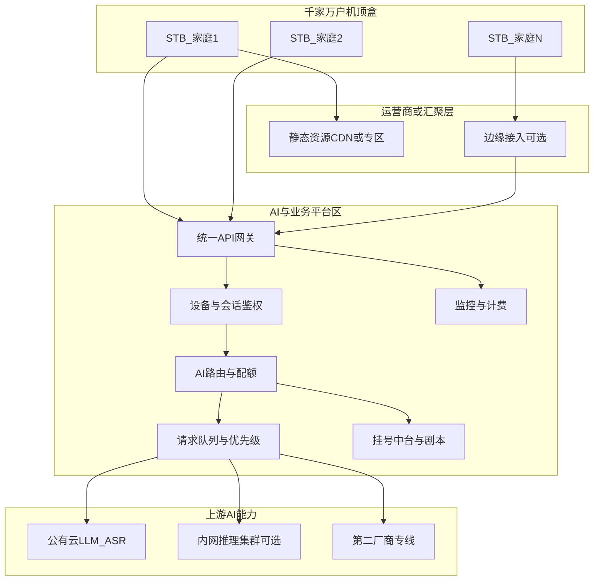
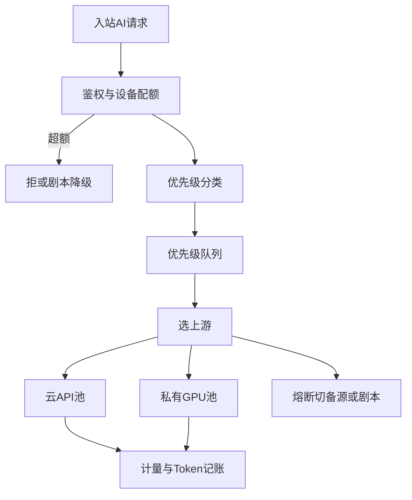
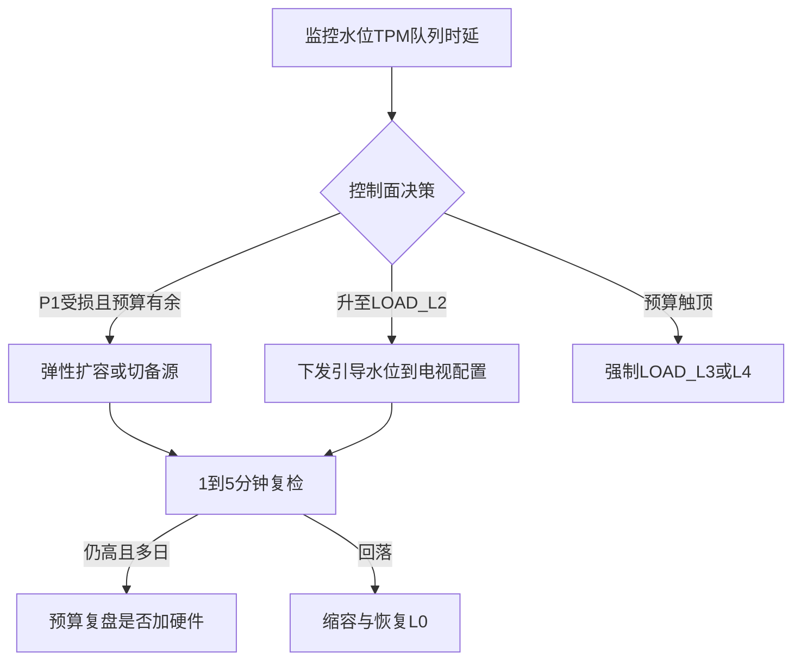

# IPTV 宽带电视 · AI API 调用与容量调度方案

## 版本 v1.2 · 日期 2026-11-08

| 项 | 内容 |
|---|---|
| 场景 | 广电/电信 IPTV 宽带电视机顶盒，数字人挂号与健康对话 |
| 目标 | 千家万户可调用 AI API；前期 Token 重可控；硬件与链路可协调调度；**瓶颈时可扩容可引导** |
| 前提 | **盒子不跑大模型**；统一走 API 路由（见 [03](../03-AI对话与API切换方案-v1.2.md)） |
| 关联 | [00](../00-项目总方案-v1.2.md)、[05](../05-数字人精灵图与动作方案-v1.3.md)、[06](../06-接口清单与数据契约-v1.2.md)、[07](../07-跨端迁移方案-v1.0.md)、[09](../09-上线边界与运营治理补强-v1.0.md) |
| 本版增量 | 水位统一称 `LOAD_L*`；远程配置签名/灰度要点；PII；链到 09 |

---

## 1. 要解决的问题

| 问题 | 表现 | 本方案对策 |
|---|---|---|
| 怎么调 | 每台电视如何安全、统一地打到 AI | 机顶盒 → 运营商/院内 **AI 接入网关** → 上游 API |
| 人多怎么稳 | 晚高峰同时说话，连接与限流打满 | 分层限流、排队、熔断、多上游负载、剧本降级 |
| Token 重怎么扛 | 前期对话长、重复多、费用与延迟双高 | 意图分流少调 LLM、缓存、短上下文、配额、错峰与模型分级 |
| AI 碰到瓶颈怎么办 | 排队变长、超时、费用飙升 | **双轨**：秒～分钟级引导降级保体验；分钟～小时级弹性扩容；天级预算复盘是否加硬件（见第 6 章） |

**协调原则一句话**：业务要稳、成本要控、算力要按优先级排队；瓶颈时 **先引导保挂号，再弹性扩容，后预算定容**，三件事由同一套控制面协调，而不是只堆机器或只挡用户。

---

## 2. 端到端调用架构（宽带电视）



### 2.1 各层职责

| 层 | 职责 | 不做 |
|---|---|---|
| 机顶盒 / WebView | 采集语音或按键、展示字幕与数字人、调 `/api/*` | 存 API Key、跑模型 |
| 统一 API 网关 | TLS、鉴权、限流、路由、协议适配 | 业务挂号逻辑细节可转发中台 |
| AI 路由与配额 | 选上游、Token/QPS 预算、降级 | 直接改前端 |
| 请求队列 | 高峰排队、优先级（危急/挂号确认 > 闲聊） | 无限积压 |
| 上游 | 真正 ASR/LLM/TTS | 感知具体家庭业务（尽量脱敏） |
| 监控计费 | 按设备/套餐/接口计量 | — |

### 2.2 电视侧调用方式（与 Demo 同构）

```text
电视前端
  → HTTPS 仅访问：https://ai-gw.xxx/api/chat | /api/asr | /api/tts
  → Header: Authorization: Bearer <deviceSessionToken>
  → 网关校验设备绑定与配额后，转发到当前路由目标
```

与网页 Demo 的差异：**代理从本机 Node 换成运营商/院内部署的高可用网关**；路径契约保持 [06](../06-接口清单与数据契约-v1.2.md) 不变，便于迁移。

### 2.3 网络路径注意点（IPTV 宽带）

| 点 | 建议 |
|---|---|
| 专网/VPN | 机顶盒到网关走 IPTV 业务专网或运营商约定域名，避免家庭公网裸奔 Key |
| DNS | 内网解析 `ai-gw`；故障可切备用域名 |
| 超时 | 首包超时与整请求超时分开配（流式聊天尤其重要） |
| 音频上行 | ASR 音频走同网关；限制单请求体大小；高峰可降采样策略 |
| 静态资源 | 数字人精灵图走 CDN，不与 AI 网关抢连接池 |

---

## 3. 「千家万户」规模怎么估算

以下为 **容量规划用粗算模型**，落地前用试点数据校准。

### 3.1 关键变量

| 符号 | 含义 | 示例假设（可改） |
|---|---|---|
| `N` | 开通数字人能力的机顶盒数 | 10,000 / 50,000 / 100,000 |
| `α` | 晚高峰同时在线使用比例 | 2%～5% |
| `R` | 活跃用户每分钟对话轮次 | 0.5～1 |
| `C_llm` | 每轮触发 LLM 的比例 | 前期 0.6；优化后 0.2～0.3（挂号多走剧本） |
| `T_in/T_out` | 每轮输入/输出 Token | 前期偏高；优化后压低 |

### 3.2 并发与 QPS 粗算

```text
同时活跃用户 U = N × α
LLM 请求 QPS ≈ U × R × C_llm / 60
```

示例：`N=50,000`，`α=3%`，`U=1,500`，`R=1`，`C_llm=0.3`  
→ LLM QPS ≈ `1500 × 1 × 0.3 / 60 ≈ 7.5`（稳态）  
晚高峰突发按 **3～5 倍** 留冗余 → 网关与上游按 **25～40 QPS** 量级备（再加 ASR）。

ASR 通常与「按键说话」绑定，峰值可能高于 LLM；需单独按「同时 LISTENING 路数」估连接与带宽。

### 3.3 连接与硬件相关指标

| 指标 | 说明 |
|---|---|
| 网关入站连接 | 长连接/SSE 数 ≈ 同时 SPEAKING+流式用户 |
| 上游连接池 | 每上游最大并发；超出进队列 |
| 带宽 | ASR 上行 + TTS 下行；与 CDN 流量分开计量 |
| 自建推理卡 | 若有私有化 LLM，按「并发生成路数」定卡数，而不是按开通用户数 N |

**重要**：开通 10 万户 ≠ 需要 10 万路模型；真正吃硬件的是 **并发推理路数** 与 **Token 速率**。

---

## 4. 前期 Token 重：治理与协调

前期 Token 重通常因为：上下文过长、每轮都打大模型、系统提示词臃肿、重复确认、闲聊无缓存。

### 4.1 分层：哪些必须调 API，哪些不要

| 流量类型 | 是否调 LLM | 策略 |
|---|---|---|
| 危急词 | 否 | 本地/网关规则短路 |
| 挂号槽位确认 | 否 | 确定性剧本 + 中台 |
| 症状导诊 | 可选 | 规则库优先；模糊句才调小模型/短上下文 |
| 闲聊/解释 | 是 | 限轮次、限 maxTokens、可用便宜模型 |
| ASR | 是（云） | 热词表、短音频；失败 mock/按键 |

这样把「千家万户」的大部分操作挡在 **剧本与中台**，LLM 只处理真正需要理解的部分。

### 4.2 Token 预算与配额

| 机制 | 做法 |
|---|---|
| 每设备日配额 | 如每日 LLM Token 上限；用尽后强制剧本 + 友好提示 |
| 每会话上限 | 单次开机会话 maxTokens / 最大轮次 |
| 套餐分级 | 基础户仅挂号剧本；增值户开放闲聊额度 |
| 家庭账户共享池 | 多成员共用一户配额，防一台电视刷爆 |
| 上游分账 | 演示云 / 内网推理 / 厂商 B 分别记账，方便对比成本 |

### 4.3 降本技术手段（与业务方案对齐）

| 手段 | 效果 |
|---|---|
| 短系统提示词 + 分场景模板 | 减少每轮固定输入 Token |
| 历史只留最近 4～6 轮，摘要压缩 | 控上下文 |
| 语义缓存 | 高频问答（血压怎么测）命中缓存不打模型 |
| 模型分级 | 闲聊小模型；难句再升大模型 |
| 流式早停 | 用户打断立即 abort，停计输出 Token |
| speak 前期 text | 少打 TTS API（见 05） |

### 4.4 前期「Token 重」运营协调

```text
产品：收紧会调 LLM 的意图面
网关：配额 + 排队 + 熔断
财务：日/周 Token 看板，超阈值告警
运维：高峰扩容上游或降级到剧本
```

出现费用尖峰时，控制面按策略自动：**限闲聊 → 降模型档 → 只保留挂号与危急**。

---

## 5. 硬件与算力调度（如何协调）

这里的「硬件」包含两类：

1. **平台侧**：网关、队列、缓存、数据库、（可选）私有化 GPU 推理集群  
2. **采购侧**：公有云/厂商 API 的并发配额与专线带宽（也按「资源池」调度）

盒子本身不参与 AI 算力调度。

### 5.1 资源池模型

| 资源池 | 调度对象 | 单位 |
|---|---|---|
| 网关池 | CPU/连接/TLS | 连接数、QPS |
| 队列池 | 等待中的 AI 请求 | 队列深度、等待时长 |
| 云 API 池 | 厂商并发与 TPM（Token per minute） | RPM/TPM |
| 私有 GPU 池 | 推理实例 | 并发路数、tokens/s |
| 剧本池 | 本地/中台话术 | 近乎无限，作兜底 |

### 5.2 优先级（统一队列）

| 优先级 | 典型请求 | 调度 |
|---|---|---|
| P0 | 危急指引（通常不调 LLM） | 本地规则，占网关即可 |
| P1 | 挂号确认、预占相关短应答 | 优先出队；可用缓存/剧本 |
| P2 | 导诊理解 | 允许短排队；超时降级规则库 |
| P3 | 闲聊 | 最易限流/降级；配额用尽直接剧本 |

### 5.3 调度策略（控制面）



| 策略 | 说明 |
|---|---|
| 负载均衡 | 多上游按健康度、延迟、剩余 TPM 加权 |
| 熔断 | 错误率/超时超阈，摘除上游 30～60s |
| 过载保护 | 队列深度超限时，拒绝 P3，保障 P1 |
| 弹性 | 私有 GPU 按并发扩缩；云侧提额或切备厂商 |
| 亲和 | 同一会话尽量粘同一上游，减少前缀缓存未命中（若上游支持） |

### 5.4 自建 GPU 何时需要、如何定容

| 条件 | 建议 |
|---|---|
| 仅 Demo / 小流量试点 | **不自建**，全走 API |
| 日 Token 与隐私要求双高 | 评估内网推理；仍经同一网关 |
| 定容方法 | 压测「目标并发路数 × 每路 tokens/s」→ 卡型与卡数；再留 30%～50% 冗余 |
| 与云协同 | 私有池打满 → 溢流到云（需合规允许）或降级剧本 |

### 5.5 与「千家万户」的协调节奏

| 阶段 | 用户规模 | 平台形态 | 调度重点 |
|---|---|---|---|
| 试点 | 百～千户 | 单可用区网关 + 公有云 API | 配额、埋点、Token 基线 |
| 区县扩 | 千～万户 | 网关双活 + 队列 + 多上游 | 晚高峰限流、P3 降级 |
| 全市级 | 万～十万户 | 多机房、CDN、专线、可选 GPU | 分池配额、自动熔断扩容 |
| 持续运营 | — | 成本与 SLA 看板 | 模型分级与缓存命中率 |

---

## 6. 瓶颈时的动态扩展：扩容算力，还是引导流程？

**结论（定稿）**：不是二选一，而是 **按时间尺度双轨并行**。

| 时间尺度 | 主手段 | 目的 |
|---|---|---|
| 秒～2 分钟 | **引导 / 降级流程**（产品侧） | 立刻保住挂号与危急，避免电视端卡住 |
| 2～30 分钟 | **弹性扩容 / 切备源**（平台侧） | 消化真实高峰，缩短排队 |
| 按周 / 按月 | **预算定容 + 是否加硬件**（经营侧） | 高峰变成常态时再买卡/提云额度 |

只扩容不引导：晚高峰费用与排队仍可能把老人晾在「转圈」上。  
只引导不扩容：长期「系统忙」会伤信任，且掩盖真实容量缺口。

### 6.1 瓶颈类型（先分清再调度）

| 瓶颈类型 | 信号 | 优先动作 |
|---|---|---|
| 上游 TPM/并发打满 | 429、排队升高、首字变慢 | 压 P3 → 切备源/提额 → 再考虑扩 GPU |
| 网关连接/CPU 打满 | 入站超时、握手失败 | 扩网关副本（快）；同时限制新闲聊 |
| 私有 GPU 打满 | 推理队列长、tokens/s 触顶 | 溢流到云（合规允许）或扩副本；同时引导 |
| Token 日预算打满 | 计量告警 | **引导为主**（剧本/改日再聊）；扩容解决不了账单 |
| 单厂商故障 | 5xx、熔断打开 | 切备源；引导仅作短暂垫片 |

### 6.2 决策矩阵：何时扩容，何时引导

| 判断条件 | 扩容算力 / 提云额度 | 引导降级流程 |
|---|---|---|
| 短时尖峰（晚会、流感季一晚）且预算内有弹性额度 | 自动弹性（预设上限内） | 同时开启轻引导（排队提示） |
| 尖峰但弹性额度已用尽 | 告警人工提额 | **必须**引导：少问一句、转按键、闲聊关闭 |
| 连续 N 天高峰同类指标打满（如 5 晚） | 启动定容扩容立项 | 高峰时段保留引导作为常态缓冲 |
| 纯费用/Token 超预算 | 不盲目扩 | 收紧意图面、配额、模型降档 |
| 挂号 P1 已受影响 | 紧急扩容 + 切备源 | 立即「保挂号模式」：闲聊关、导诊缩短 |
| 仅 P3 闲聊变慢 | 可不扩 | 排队提示或稍后再说 |

### 6.3 引导流程（预算内必做的产品垫片）

引导不是「报错了事」，而是 **老人听得懂的下一步**。数字人 / 字幕需同步（speak 可用 text 模式）。

| 水位 | 系统状态 | 电视侧引导（示例话术） | 业务行为 |
|---|---|---|---|
| `LOAD_L0` 正常 | 队列空、余量足 | 无额外提示 | 全功能 |
| `LOAD_L1` 繁忙 | 等待 P95 > 阈值或 TPM > 70% | 「现在问的人比较多，我稍微慢一点」 | 缩短闲聊；导诊可继续 |
| `LOAD_L2` 拥堵 | 等待 > 2s 或 TPM > 85% | 「为了先帮您挂上号，我们先用简单问答」 | 关闲聊；导诊规则优先；少调大模型 |
| `LOAD_L3` 过载 | 队列拒收或上游熔断 | 「系统有点忙。您可以按键选科室，或稍后再试；危急请打 120」 | 仅剧本预约 + 危急；LLM 可关 |
| `LOAD_L4` 配额用尽 | 该户/全局 Token 到顶 | 「今天的智能问答次数用完了，预约还可以用按键」 | 本户 LLM 停；预约中台仍可用 |

> 命名：`LOAD_*` 专指拥堵水位，勿与就诊人 `PATIENT_L*`、打断 `INTERRUPT_*` 混用。远程配置签名/灰度/回滚见 [09 §9](../09-上线边界与运营治理补强-v1.0.md)。

**注意**：LOAD 剧本预约 ≠ 家庭断网仍可真实下单；断网边界见 09 §1。

原则：

1. **挂号主路径尽量不断**：预占/确认走中台，不依赖 LLM 高峰算力  
2. **先夺回控制权**：大按钮（选科室 / 再说 / 退出），避免干等  
3. **说清楚原因**：繁忙，不是「坏了」  
4. **水位可配置**：与监控阈值绑定，自动升降，无需改盒端发版（远程配置）

### 6.4 动态扩容（硬件 / 云额度）怎么做

| 资源 | 弹性方式 | 建议上限（预算内） |
|---|---|---|
| 网关 / 队列节点 | 容器水平扩容（HPA） | 按连接与 CPU；扩得快，优先自动化 |
| 公有云 API | 合同内自动升并发/TPM；多厂商溢流 | 设 **月度费用硬顶**；触顶转引导 |
| 私有 GPU | 推理副本 +1；冷启动预热 | 设 **卡数上限**；超出溢流或引导 |
| ASR | 同网关限流；必要时升专用配额 | 音频贵，高峰可提示「请按键」 |

扩容门禁（避免费用失控）：

```text
自动扩容仅在「预算池剩余 > 0」且「P1 受损或预测将受损」时触发
扩容后仍 L2 持续 15 分钟 → 升 L3 引导，并工单通知人工提预算
禁止：无上限追着尖峰买算力
```

### 6.5 统一控制面：一分钟内怎么协调



| 角色 | 职责 |
|---|---|
| 控制面 | 读指标、改水位、触发扩缩、切路由 |
| 产品 / 数字人 | 维护各水位话术与按键菜单 |
| 运维 | 弹性上限、熔断、演练 |
| 经营 | 月度 Token/卡预算、是否把弹性改成常备容量 |

### 6.6 预算怎么「先考虑好」

建议把年度/季度预算拆成三桶，避免临时拍板：

| 预算桶 | 用途 | 占比示意（可调） |
|---|---|---|
| 常备容量 | 覆盖日常 80% 分位高峰 | 60%～70% |
| 弹性尖峰 | 晚会/流感季自动扩容 | 20%～30% |
| 体验兜底 | 引导流程开发与演练、剧本维护 | 5%～10%（人力与内容，不全是云费） |

评审时固定回答两句：

1. **尖峰前 2 分钟**：靠引导 + 限流，不让老人对着转圈。  
2. **尖峰成为常态**：用弹性数据证明需要加常备算力，再采购；不是第一晚就堆满卡。

### 6.7 验收（动态扩展）

| 编号 | 场景 | 期望 |
|---|---|---|
| E1 | 压测打满 TPM | 自动升至 L2/L3，挂号 P1 仍可完成 |
| E2 | 预算池仍有余且 P1 受损 | 触发扩容或切备源，水位随后回落 |
| E3 | 预算池为 0 | 不扩容；L4 引导；挂号按键可用 |
| E4 | 高峰结束 | 自动缩容；话术恢复 L0 |
| E5 | 连续 5 个晚高峰 L2+ | 产出扩容立项材料（数据自动导出） |

---

## 7. 高可用与安全

| 项 | 要求 |
|---|---|
| 网关 | 至少双实例；健康检查；配置热更新（对齐 Demo「改配置即生效」思想） |
| 密钥 | KMS/保险柜；按环境隔离；盒端永不下发 |
| 鉴权 | 设备 Token + 可选机顶盒账号绑定；防刷 |
| 隐私 | 日志脱敏；音频默认不落盘或短时加密落盘 |
| 审计 | 谁在何时调了哪类 API、Token 消耗、是否降级 |
| 合规 | 医疗话术与出网数据范围按院方/运营商规范 |

---

## 8. 观测指标（调度是否健康）

| 类别 | 指标 |
|---|---|
| 体验 | 首字时延、整轮时延、打断成功率、降级率 |
| 规模 | 在线设备、同时流式连接、队列等待 P95 |
| 成本 | Token/日、单户成本、缓存命中率、LLM 调用占比 |
| 上游 | 错误率、TPM 使用率、熔断次数 |
| 硬件 | GPU 利用率、网关 CPU、带宽 |

告警示例：TPM > 80% 持续 5 分钟 → 升 `LOAD_L2` 并压闲聊；队列等待 > 2s 且预算有余 → 扩容或切备源；预算触顶 → 只引导不扩容。

---

## 9. 与现有业务方案的接口关系

| 业务文档能力 | 本建设方案落点 |
|---|---|
| `/api/chat` `/api/asr` | 网关统一入口 |
| Provider `baseUrl` 切换 | 路由表 / 控制面 |
| 剧本降级 | 过载与配额用尽（`LOAD_L2`～`LOAD_L4`） |
| 设备 Session | 鉴权与分户/租户配额键 |
| 绑定/预约中台 | 尽量不经 LLM；瓶颈时按键预约；**到院付**见 09 |
| 远程配置水位 | 控制面下发 `LOAD_*`（签名/灰度见 09） |
| PII | 遥测不落 ASR 原文 |

---

## 10. 分期建设清单（可执行）

| 期 | 建设内容 | 验收 |
|---|---|---|
| S0 Demo | 本机 Node 代理 + 公有云 | 与 03 一致，单机可切换上游 |
| S1 试点网关 | 院内/运营商一套 API 网关 + 鉴权 + 基础限流 + 计量 | 百户同时用可完成挂号 |
| S2 容量与Token | 配额、优先级队列、缓存、模型分级 | 晚高峰 P1 不受 P3 拖死；日成本可控 |
| S2b 引导水位 | `LOAD_L0`～`L4` 话术与签名配置、压测联动 | E1/E3：忙时能预约、不干等 |
| S3 多活与备源 | 双上游 + 熔断溢流 + **预算内自动弹性** | 单厂商故障自动切；有预算才扩容 |
| S4 可选私有化 | GPU 池纳入同一调度；多日高峰定容复盘 | 溢流与降级演练通过；有数据再买卡 |

---

## 11. 决策摘要（给评审用）

1. **千家万户靠网关与配额，不靠每户一台推理机。**  
2. **前期 Token 重：用意图分流 + 配额 + 短上下文 + 缓存治理，而不是先堆硬件。**  
3. **硬件（含云 TPM 与自建 GPU）纳入统一优先级队列调度，与业务危急/挂号优先级一致。**  
4. **电视只调统一 API；换云、换内网、加密级扩容，都不改机顶盒业务包核心逻辑。**  
5. **AI 瓶颈：秒级靠引导降级保挂号；分钟级在预算内弹性扩容；天级用数据决定是否加常备硬件。禁止无上限追峰扩容。**  

---

## 12. 修订记录

| 版本 | 日期 | 说明 |
|---|---|---|
| v1.0 | 2026-11-08 | 首版：IPTV 调用链路、规模粗算、Token 治理、硬件/队列调度、分期建设 |
| v1.1 | 2026-11-08 | 新增第 6 章：动态扩展双轨、瓶颈决策矩阵、引导水位、预算三桶、扩容门禁 |
| v1.2 | 2026-11-08 | 统一 `LOAD_*` 命名；远程配置链到 09；断网≠剧本下单；PII |
